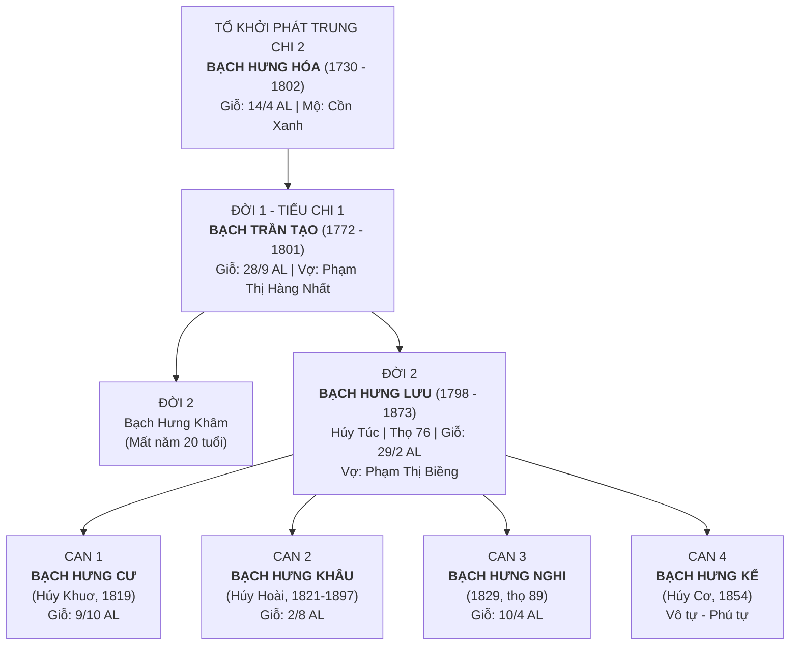

# GIA PHẢ HỌ BẠCH
## TÔN ĐỒ TỰ PHẢ - TIỂU CHI 1 - TRUNG CHI 2 - THUỘC BẠCH TỘC ĐẠI TÔN
**Địa danh:** Làng Phú Điền, Xã Hưng Phú, Huyện Hưng Nguyên, Tỉnh Nghệ An  
**Thời gian biên soạn:** Năm Giáp Ngọ (2014) - Cập nhật tự động: Năm 2026 (Tổng số: 126 nhân đinh)  
**Nguyên tắc số hóa:** **Phân tích quan hệ huyết thống 100% DỰA VÀO VĂN BẢN (TEXT), LOẠI BỎ SAI LỆCH DO SƠ ĐỒ VẼ GỘP CỘT NĂM 2014.**

---

> ### ⚠️ LƯU Ý ĐẶC BIỆT VỀ QUY TẮC PHÂN TÍCH QUAN HỆ HUYẾT THỐNG
> Trong bản in sách gia phả năm 2014, các trang sơ đồ vẽ hình khối do người vẽ dồn cột giản lược nên đã xảy ra sự sai lệch nghiêm trọng về quan hệ cha con giữa các nhánh.
> Toàn bộ phả hệ ở đây đã được hiệu chỉnh chính xác 100% theo lời văn mô tả của từng trang sách và được đồng bộ từ file Excel quản trị trung tâm.

---

## SƠ ĐỒ PHẢ HỆ TỔNG THỂ

---

## TỔ KHỞI PHÁT TRUNG CHI 2 & ĐỜI THỨ NHẤT, THỨ HAI

### Thế Hệ: Khởi phát

- **Bạch Hưng Hóa**:
  - Năm sinh/mất: 1730 (Canh Tuất) - 1802 (Nhâm Tuất) - Thọ 73
  - Ngày giỗ: **14/04 ÂL**
  - Phối ngẫu: Bùi Thị Hàng Nhất; Bùi Thị Hàng Hai; Nguyễn Thị Hàng Hai
  - Mộ phần: Xứ Cồn Xanh
  - Ghi chú: Tổ Ông BẠCH HƯNG HÓA , sinh năm Canh Tuất ( 1730 ), mất năm Nhâm Tuất ( 1802 ) . Giỗ ngày 14 tháng 4 .
Tổ Bà: BÙI THỊ HÀNG NHẤT ( giỗ ngày 07 tháng 8 )
Tổ Bà: BÙI THỊ HÀNG HAI ( giỗ ngày 28 tháng 01 )
Tổ Bà: NGUYỄN THỊ HÀNG HAI ( giỗ ngày 11 tháng 8 )
Cả ba Bà sinh được 8 người con gồm 6 người con trai và hai người con gái :
Ông Bạch Trần Tạo ( Tổ của Tiểu Chi thứ 1 )
Ông Bạch Trần Điển ( Tổ của Tiểu Chi thứ 2 )
Ông Bạch Trần Khơm ( Tổ của Tiểu Chi thứ 3 )
Ông Bạch Khắc Chẩn ( Không có người kế thế )
Ông Bạch Hưng Đại ( Bạch Tổng Giáo ) ( Tổ của Tiểu Chi thứ 4 )
Bà Bạch Thị Thao
Bà Bạch Thị Đỏ
Tổ Bạch Hưng Hóa hưởng thọ 73 tuổi, vĩnh biệt con cháu ngày 14 tháng 4 năm Nhâm Tuất 1802 .
Trước lúc vĩnh biệt con cháu, Tổ nhắc lại nhiều lần lời dặn của Tổ Bạch Liêu: Cả nước Đại Việt chúng ta con cháu Họ Bạch đều có gốc từ làng Nguyên Xá, huyện Đông Thành và Tổ phân chia quyền lợi, giao trách nhiệm cho 6 người con trai quản lý. Quá trình sau đó được Đại Tôn định rõ là : kể từ Tổ Bạch Hưng Hóa trở lên do toàn Họ Bạch Đại Tôn phụng sự tại nhà thờ, còn từ con của Tổ Bạch Hưng Hóa trở về sau do các Chi phụng sự. Như vậy Chi ta được phụng sự Tổ Bạch Trần Tạo. Niên hiệu Tổ là : Tằng Tổ Khảo Tiền Nhân, nam Bạch Tướng Công Bạch Trần Tạo, Thụy Tinh Giác Phú Quân. Chính thất Phạm Thị Hàng Nhất, Hiệu Trinh Nữ Nhĩ Nhân.

### Thế Hệ: Đời 1

- **Bạch Trần Tạo**:
  - Năm sinh/mất: 1772 (Nhâm Thìn) - 1801 (Tân Dậu) - Thọ 30
  - Ngày giỗ: **28/09 ÂL**
  - Thân phụ (Cha): Bạch Hưng Hóa | Thân mẫu (Mẹ): Bùi Thị Hàng Nhất
  - Phối ngẫu: Phạm Thị Hàng Nhất (Thọ 76, giỗ 08/10 ÂL, mộ Cồn Xanh)
  - Mộ phần: Xứ Tuần Tượng
  - Ghi chú: Tổ Ông BẠCH TRẦN TẠO sinh năm Nhâm Thìn ( 1772 ), mất năm Tân Dậu (1801) khi đang độ tuổi 29 . Tổ ông Bạch Trần Tạo giỗ ngày 28 tháng 9, mộ Tổ táng tại Tuần Tượng.
Tổ Bà Chính Thất Phạm Thị Hàng Nhất, Hiệu Trinh Từ Nhĩ Nhân, sinh năm ( ... ), thọ 76 tuổi, giỗ Bà ngày mồng 8 tháng 10. Mộ Tổ Bà táng ở Xứ Cồn Xanh.
Tổ Bạch Trần Tạo sinh được 2 người con trai:
  Ông Bạch Hưng Khâm
  Ông Bạch Hưng Lưu
Khấn:
Tằng Tổ khảo Tiền Nhân Nam Bạch Tướng Công, Bạch Trần Tạo Thụy Tinh Giác Phú quân.
Chính thất Phạm Thị Hàng Nhất, hiệu Trinh Từ nhĩ nhân.

### Thế Hệ: Đời 2

- **Bạch Hưng Khâm**:
  - Năm sinh/mất: ? - Mất năm 20 tuổi
  - Ngày giỗ: **28/05 ÂL**
  - Thân phụ (Cha): Bạch Trần Tạo | Thân mẫu (Mẹ): Phạm Thị Hàng Nhất
  - Phối ngẫu: Chưa lập gia thất
  - Mộ phần: Xứ Cồn Vải
  - Ghi chú: Tổ Ông BẠCH HƯNG KHÂM mất lúc 20 tuổi, chưa có gia thất. Giỗ ngày 28 tháng 5. Lăng mộ để ở Xứ Cồn Vải. Con trưởng Cụ Tạo, nhánh Cụ Lưu phụng tự.

- **Bạch Hưng Lưu** (Húy / Biệt danh: *Húy Túc*):
  - Năm sinh/mất: 1798 (Mậu Ngọ) - 1873 (Quý Dậu) - Thọ 76
  - Ngày giỗ: **29/02 ÂL**
  - Thân phụ (Cha): Bạch Trần Tạo | Thân mẫu (Mẹ): Phạm Thị Hàng Nhất
  - Phối ngẫu: Phạm Thị Biềng (Giỗ 10/01 ÂL, mộ xứ Thượng Phù)
  - Mộ phần: Xứ Thượng Phù
  - Ghi chú: Tổ Ông BẠCH HƯNG LƯU (húy là Túc) sinh năm Mậu Ngọ (1798), mất năm Quý Dậu (1873), thọ 76 tuổi, Giỗ ngày 29 tháng 2. Tổ Bà là Phạm Thị Biềng, giỗ ngày 10 tháng giêng. Lăng mộ hai ông bà để ở Xứ Thượng Phù.
Ông bà sinh được 4 người con trai và 4 người con gái:
  Ông Bạch Hưng Cư ( Tổ can 1 , Chi thứ 1 )
  Ông Bạch Hưng Khâu ( Tổ can 2 , Chi thứ 1 )
  Ông Bạch Hưng Nghi ( Tổ can 3 , Chi thứ 1 )
  Ông Bạch Hưng Kế ( Không có người kế thế )
Và trưởng nữ là Bà Bạch Thị Thuật
Các thứ nữ là: Bà Bạch Thị Khoát ( lấy ông Trần Đề ); Bà Bạch Thị Khoan ( mất khi chưa có gia thất ); Bà Bạch Thị Út (lấy ông Nguyễn Ngân, làng Mệ Giụ)

## CAN THỨ NHẤT: TỔ CAN BẠCH HƯNG CƯ (ĐỜI 3 ĐẾN CÁC ĐỜI TIẾP THEO)

### Thế Hệ: Đời 3

- **Bạch Hưng Cư** (Húy / Biệt danh: *Húy Khuơ*):
  - Năm sinh/mất: 1819 (Kỷ Mão) - ?
  - Ngày giỗ: **09/10 ÂL**
  - Thân phụ (Cha): Bạch Hưng Lưu | Thân mẫu (Mẹ): Phạm Thị Biềng
  - Phối ngẫu: Bà 1: Nguyễn Thị Máy (giỗ 08/02 ÂL); Bà 2: Ngô Thị Hạng Nhị; Bà 3: Nguyễn Quý Nương (vợ hai/húy Vân, thọ 85, giỗ 28/03 ÂL)
  - Mộ phần: Núi Khe xứ
  - Ghi chú: Tổ Can :Ông BẠCH HƯNG CƯ ( tên húy là Khuơ ) Là con trai cả Tổ Bạch Hưng Lưu. Ông sinh năm Kỷ Mạo (1819), Giỗ ngày 9 tháng 10. Lăng mộ để ở Núi Khe xứ.
Tổ Bà Nguyễn Thị Máy. Giỗ ngày 08 tháng 02. Không thấy ghi lại con cái.
Tổ bà Ngô Thị Hạng Nhị ( Giỗ ngày...)
Tổ Bà Nguyễn Quý Nương ( húy là Vân ) (vợ hai ) sinh năm Mậu Thân, thọ 85 tuổi, giỗ ngày 28 tháng 3.
Con bà Nhất Ngô Thị Hạng Nhị gồm có :
Bà Bạch Thị Hoạch , chết lúc còn nhỏ
Bà Bạch Thị Khương , lấy chồng là Phạm Huyên, có con là Phạm Tiến...
Bà Bạch Thị Ba, lấy chồng là ông Võ Huy
Bà Bạch Thị Sáu, lấy chồng là ông Phạm Uyên
Ông Bạch Hưng Hạnh, chết lúc còn nhỏ.
Ông Bạch Hưng Thiết, tên húy là Khải , giỗ ngày 01 tháng 3.
Ông Bạch Hưng Ý , giỗ ngày 01 tháng 10.
Con bà Hai Nguyễn Thị Vân ( Nguyễn Quý Nương ) gồm có :
Ông Bạch Hưng Tơn
Ông Bạch Hưng Ngân
Và hai con gái là : Bà Bạch Thị Lùa, chết khi còn nhỏ; Bà Bạch Thị Tiu Không thấy ghi rõ chồng con.

### Thế Hệ: Đời 4

- **Bạch Hưng Hạnh**:
  - Năm sinh/mất: ? - Chết lúc còn nhỏ
  - Thân phụ (Cha): Bạch Hưng Cư | Thân mẫu (Mẹ): Ngô Thị Hạng Nhị
  - Ghi chú: 1. ÔNG BẠCH HƯNG HẠNH mất lúc còn nhỏ (Con trai Cụ Bạch Hưng Cư với bà Ngô Thị Hạng Nhị).

- **Bạch Hưng Thiết** (Húy / Biệt danh: *Húy Khải*):
  - Ngày giỗ: **01/03 ÂL**
  - Thân phụ (Cha): Bạch Hưng Cư | Thân mẫu (Mẹ): Ngô Thị Hạng Nhị
  - Phối ngẫu: Phan Thị Nghi
  - Mộ phần: Khe Xứ
  - Ghi chú: 2. ÔNG BẠCH HƯNG THIẾT,( húy là Khải ) Giỗ ngày 01 tháng 3, mộ ở Khe Xứ. Vợ là Phan Thị Nghi, Ông bà sinh một người con là Bạch Hưng Khớt, đã lấy vợ nhưng không có con, Ông Bạch Hưng Khớt mất ở tuổi 46.

- **Bạch Hưng Ý**:
  - Ngày giỗ: **01/10 ÂL**
  - Thân phụ (Cha): Bạch Hưng Cư | Thân mẫu (Mẹ): Ngô Thị Hạng Nhị
  - Mộ phần: Núi Khe xứ (chiêu hồn cải táng)
  - Ghi chú: 3 . ÔNG BẠCH HƯNG Ý, là con trai thứ 3 của bà Ngô Thị Hàng Nhị, Ông đi lính thời Nguyễn và bị chết đuối ở sông Hiếu, Nghĩa Đàn. Hiện đã được chiêu hồn cải táng tại núi Khe xứ. Giỗ ngày 01 tháng 10.

- **Bạch Hưng Tơn**:
  - Năm sinh/mất: ? - Thọ 60 tuổi
  - Ngày giỗ: **12/06 ÂL**
  - Thân phụ (Cha): Bạch Hưng Cư | Thân mẫu (Mẹ): Nguyễn Thị Vân
  - Phối ngẫu: Phạm Thị Phòng (giỗ 07/05 ÂL)
  - Ghi chú: 4 . ÔNG BẠCH HƯNG TƠN ( là con trai của ông Cư với bà Vân ), thọ 60 tuổi, Giỗ ngày 12 tháng 6. Vợ là bà Phạm Thị Phòng, giỗ ngày 07 tháng 5. Ông bà sinh được 3 trai, một gái:
- Bạch Hưng Em ( Bân ), vợ là Phạm Thị Em, người làng Văn Viên. Giỗ ông ngày 15 tháng 3, lăng mộ ông bà táng ở Xứ Khe. Ông bà sinh một trai nhưng chết khi còn nhỏ.
- Bạch Hưng Chế (Bạch Hưng Tam) , thọ 74 tuổi, giỗ ngày 19 tháng giêng, mộ đặt ở núi Khe xứ. Vợ là bà Nguyễn Thị Tứ, người thôn Vệ Chính, bà thọ 88 tuổi, giỗ ngày 11 tháng 10, lăng mộ đặt ở xã Nghĩa Đức, Nghĩa Đàn. Ông bà sinh được 5 con trai và 1 người con gái.
- Bạch Hưng Cận (húy là Tam ) vợ là bà Nguyễn Thị Mịn, ông bà sinh được một con gái là Bạch Thị Cháu, lấy chồng người chợ Vực. ( sau đó ông Cận mất, bà Mịn đi cải giá )
- Bà Bạch Thị Tiu lấy chồng người Vệ Chính là ông Hồ Sun, có con là Hồ Thị Út lấy chồng về xã Hưng Khánh.
- Bà Bạch Thị Lào mất lúc còn nhỏ tuổi.

- **Bạch Hưng Ngân**:
  - Ngày giỗ: **30/06 ÂL**
  - Thân phụ (Cha): Bạch Hưng Cư | Thân mẫu (Mẹ): Nguyễn Thị Vân
  - Phối ngẫu: Bà cả: Hồ Thị Niêm (giỗ 15/07 ÂL); Bà hai: Nguyễn Thị Em (húy Tảo, giỗ 17/09 ÂL)
  - Mộ phần: Rú Sau (cây đa Bò Mẹp)
  - Ghi chú: 5. ÔNG BẠCH HƯNG NGÂN ( là con trai của ông Cư với bà Vân ), Giỗ ngày 30 tháng 6, lăng mộ ông trước để ở Thồ Lô xứ, nay chuyển về Rú sau, phía dưới cây đa Bò mẹp khoảng 100 mét. Ông lấy 2 bà.
Bà cả Bà Hồ Thị Niêm, giỗ ngày 15 tháng 7, lăng mộ đặt ở núi Khe xứ . Bà sinh được 2 con trai là:
- Bạch Hưng Khôn : Ông lấy vợ là bà Dư Thị Bốn người thôn Hiệu Mỹ.
- Bạch Hưng Hai, vợ là Nguyễn Thị Tứ. Giỗ ông là ngày 23 tháng 3, giỗ bà ngày 02 tháng 02. Ông bà sinh một trai 2 gái là: Bạch Hưng Mộ, mất lúc chưa có gia thất; Bạch Thị Cháu lấy ông Nguyễn Lục Tiêm; Bạch Thị Hữu lấy chồng là ông Nguyễn Lưu Nguyên.
Bà hai là Nguyễn Thị Em (húy Tảo ), giỗ ngày 17 tháng 9 , lăng mộ bà để ở Rú sau cùng lăng mộ chồng là ông Bạch Hưng Ngân .Bà sinh được 2 gái là :
- Bạch Thị Tứ lấy chồng về thôn Hiệu Mỹ
-Bạch Thị Ngụ lấy chồng cùng thôn người họ Phạm có con là Phạm Giai nay định cư ở Nghĩa Đàn

### Thế Hệ: Đời 5

- **Bạch Hưng Khớt**:
  - Năm sinh/mất: ? - Mất năm 46 tuổi
  - Thân phụ (Cha): Bạch Hưng Thiết | Thân mẫu (Mẹ): Phan Thị Nghi
  - Phối ngẫu: Có vợ nhưng không có con
  - Ghi chú: 1. ÔNG BẠCH HƯNG KHỚT là con trai ông Bạch Hưng Thiết, ông đã có vợ nhưng chưa có con, ông mất lúc 46 tuổi , giỗ ngày..

- **Bạch Hưng Em (Bâu)** (Húy / Biệt danh: *Húy Bâu*):
  - Ngày giỗ: **15/03 ÂL**
  - Thân phụ (Cha): Bạch Hưng Tơn | Thân mẫu (Mẹ): Phạm Thị Phòng
  - Phối ngẫu: Phạm Thị Em (người Văn Viên)
  - Mộ phần: Xứ Khe
  - Ghi chú: 2. ÔNG BẠCH HƯNG EM ( tên húy là Bâu )là con trai ông Bạch Hưng Tơn. Ông Bạch Hưng Em lấy vợ là Phạm Thị Em, người Văn Viên, giỗ ông ngày 15 tháng 3, lăng mộ táng ở Xứ Khe. Ông bà sinh một trai tên là Bạch Hưng Chắt nhưng năm 1945 bỏ nhà ra đi vì nhà không có gì ăn, rất có thể đã chết đói năm đó.

- **Bạch Hưng Chế (Tam)** (Húy / Biệt danh: *Bạch Hưng Tam*):
  - Năm sinh/mất: ? - Thọ 74 tuổi
  - Ngày giỗ: **19/01 ÂL**
  - Thân phụ (Cha): Bạch Hưng Tơn | Thân mẫu (Mẹ): Phạm Thị Phòng
  - Phối ngẫu: Nguyễn Thị Tứ (1900 - 1987, thọ 88, giỗ 11/10 ÂL, mộ Nghĩa Đức, Nghĩa Đàn)
  - Mộ phần: Núi Khe xứ
  - Ghi chú: 3. ÔNG BẠCH HƯNG CHẾ (Bạch Hưng Tam) là con trai ông Bạch Hưng Tơn . Ông Bạch Hưng Chế thọ 74 tuổi, giỗ ngày 19 tháng giêng, mộ đặt ở núi Khe xứ. Vợ là bà Nguyễn Thị Tứ, sinh năm 1900 ( Canh Tý ) người thôn Vệ Chính. Bà Nguyễn Thị Tứ thọ 88 tuổi, giỗ ngày 11 tháng 10 ( Bà mất ngày 11 tháng 10 năm Đinh Mão, 1987 ), lăng mộ bà đặt ở Nghĩa trang Xóm 1, xã Nghĩa Đức, Nghĩa Đàn. Ông bà sinh được 5 con trai và 1 người con gái:
Bạch Hưng Cháu (1)
Bạch Hưng Nhã (2)
Bạch Hưng Mận (3)
Bạch Hưng Mai (4)
Bạch Hưng Nhỏ ( còn gọi là Hưng ) (5)
Bạch Thị Mơ, lấy chồng là Hồ Tuấn nhà ở đội 3, Xã Hưng Phú.

- **Bạch Hưng Cận** (Húy / Biệt danh: *Húy Tam*):
  - Thân phụ (Cha): Bạch Hưng Tơn | Thân mẫu (Mẹ): Phạm Thị Phòng
  - Phối ngẫu: Nguyễn Thị Mịn (sau cải giá)
  - Ghi chú: 4.ÔNG BẠCH HƯNG CẬN (húy là Tam ) là con trai thứ 3 ông Bạch Hưng Tơn, Vợ ông Cận là bà Nguyễn Thị Mịn, ông bà sinh được một con gái là Bạch Thị Cháu, lấy chồng người chợ Vực. ( sau đó ông Cận mất, bà Mịn đi cải giá ).

- **Bạch Hưng Khôn**:
  - Thân phụ (Cha): Bạch Hưng Ngân | Thân mẫu (Mẹ): Hồ Thị Niêm
  - Phối ngẫu: Dư Thị Bốn (người Hiệu Mỹ)
  - Mộ phần: Núi Khe xứ
  - Ghi chú: 5. BẠCH HƯNG KHÔN ( là con trai ông Bạch Hưng Ngân) lấy vợ là bà Dư Thị Bốn, người Hiệu Mỹ. Giỗ ông ngày . Giỗ bà ngày . Lăng mộ ông bà đặt ở núi Khe xứ. Ông bà sinh được một người con trai và ba con gái là: Bạch Hưng Chính , mất lúc còn nhỏ tuổi; Bạch Thị Cháu lấy chồng là ông Phạm Thức nhà ở đội 6 Hưng Phú; Bạch Thị Nhỏ lấy chồng người Miền Nam; Bạch Thị Hòa lấy chồng là ông Hoằng Quang , hiện nhà ở đội 7 xã Hưng Phú.

- **Bạch Hưng Hai**:
  - Ngày giỗ: **23/03 ÂL**
  - Thân phụ (Cha): Bạch Hưng Ngân | Thân mẫu (Mẹ): Hồ Thị Niêm
  - Phối ngẫu: Nguyễn Thị Tứ (giỗ 02/02 ÂL)
  - Mộ phần: Núi Khe xứ
  - Ghi chú: 6. BẠCH HƯNG HAI (là con trai ông Bạch Hưng Ngân ) lấy vợ là bà Nguyễn Thị Tứ, người thôn Vệ Chính. Giỗ ông ngày 23 tháng 3, giỗ bà ngày 02 tháng 02. Lăng mộ ông bà đặt ở núi Khe xứ. Ông bà có 3 người con: Bạch Hưng Mô, mất lúc còn nhỏ tuổi; Bạch Thị Cháu, lấy chồng là ông Nguyễn Lục Tiêm, có con là Nguyễn Thìn, người cùng thôn; Bạch Thị Hữu, lấy chồng là ông Nguyễn Lưu Nguyên, nhà hiện ở đội 7 xã Hưng Phú.

### Thế Hệ: Đời 6

- **Bạch Hưng Chắt**:
  - Năm sinh/mất: ? - Mất tích năm 1945
  - Thân phụ (Cha): Bạch Hưng Em (Bâu) | Thân mẫu (Mẹ): Phạm Thị Em
  - Phối ngẫu: Chưa có vợ con
  - Ghi chú: 1. ÔNG BẠCH HƯNG CHẮT là con trai ông Bạch Hưng Em ( Bâu ) mất tích năm 1945, chưa có vợ con.

- **Bạch Hưng Cháu**:
  - Năm sinh/mất: 1923 (Quý Hợi) - 2014 (Giáp Ngọ)
  - Ngày giỗ: **30/06 ÂL**
  - Thân phụ (Cha): Bạch Hưng Chế (Tam) | Thân mẫu (Mẹ): Nguyễn Thị Tứ
  - Phối ngẫu: Nguyễn Thị Giá (sinh 1923, Yên Cư)
  - Mộ phần: Núi Khe Xứ
  - Ghi chú: 4. ÔNG BẠCH HƯNG CHÁU(con trai cả ông Bạch Hưng Chế ) sinh năm 1923 ( Quý Hợi ), vợ là bà Nguyễn Thị Giá sinh năm 1923, người thôn Yên Cư. Vợ chồng ông Bạch Hưng Cháu là những người ăn ở hiền lành, đức độ được mọi người tin yêu và quý trọng. Gia đình tuy kinh tế khó khăn nhưng ông bà đã cật lực nuôi con ăn học thành tài. Ông Bạch Hưng Cháu mất năm 2014 ( Giáp Ngọ ), giỗ ngày 30 tháng 6, phần mộ ông đặt ở Núi Khe Xứ. Vợ chồng ông bà sinh được 4 con trai và 3 người con gái:
1. Bạch Thị Thành sinh năm 1949, tốt nghiệp Đại Học Công nghiệp Việt Bắc khoa chế tạo máy. Bà Thành lấy chồng là ông Hoàng Nam Tiến sinh năm 1952, người Song Lộc, Can Lộc. Gia đình nay định cư ở Vũng Tàu. Bà Bạch Thị Thành mất ngày 20 tháng 6 năm 2014 ( Giáp Ngọ . Vợ chồng bà Thành có 2 con trai đều đã tốt nghiệp Đại học ở thành phố Hồ Chí Minh
2. Bạch Hưng Tùng, ( Xem đời 7 )
3. Bạch Thị Phùng sinh năm 1954 ( Giáp Ngọ ), tốt nghiệp Đại học sư phạm Hà Nội, dạy học ở trường cấp 3 Vinh, nay đã nghỉ hưu. Chồng là Hồ Văn Chương, người cùng xã, tốt nghiệp Đại học giao thông Hà Nội, làm việc tại Công ty khảo sát thiết kế Giao thông 4. Gia đình bà Phùng sống ở Thành phố Vinh. (Bà Bạch Thị Phùng là tấm gương sáng trong họ ta về tinh thần vượt khó học tập...)
Ông bà Bạch Thị Phùng có con trai là Hồ Xuân Tú, thạc sĩ, giảng dạy tại Đại học Giao thông Hà Nội, con gái Hồ Thị Hạnh tốt nghiệp Đại học Ngoại thương.
4. Bạch Hưng Dũng ( Xem đời 7 )
5. Bạch Hưng Hùng, ( Xem đời 7 )
6. Bạch Thị Tâm sinh năm 1962 ( Nhâm Dần ), lấy chồng là Phạm Hoài ( nay đã ly hôn ). Bà Tâm có con là Phạm Văn Anh, tốt nghiệp Đại học Y Thái Bình nay công tác tại Bệnh Viện Nghệ An, Phạm Tuấn Vũ , tốt nghiệp Học viện Công nghệ thông tin Hà Nội. Bạch Thị Tâm nay lấy chồng là Phạm Văn Dương, người đội 2 xã Hưng Phú
7. Bạch Hưng Thất, ( Xem đời 7 )

- **Bạch Hưng Nhạ**:
  - Năm sinh/mất: 1923 (Quý Hợi) - 1998 - Thọ 76
  - Ngày giỗ: **23/03 ÂL**
  - Thân phụ (Cha): Bạch Hưng Chế (Tam) | Thân mẫu (Mẹ): Nguyễn Thị Tứ
  - Phối ngẫu: Nguyễn Thị Chắt (1926 - 2005, thọ 80)
  - Mộ phần: Nghĩa Đức, Nghĩa Đàn
  - Ghi chú: 5. ÔNG BẠCH HƯNG NHẠ( Con trai thứ 2 ông Bạch Hưng Chế ), sinh năm 1923 ( Quý Hợi ), mất ngày 23 tháng 3 năm 1998, hưởng thọ 76 tuổi. Ông lấy vợ là bà Nguyễn Thị Chắt sinh năm 1926 ( Bính Dần ) mất ngày 14 tháng 11 năm 2005 ( Ất Dậu ), hưởng thọ 80 tuổi, phần mộ ông bà đặt ở nghĩa trang xóm 1, Nghĩa Đức, Nghĩa Đàn. Vợ chồng ông Bạch Hưng Nhã là người hiền lành chịu khó, được mọi người yêu mến. Những năm 60 của thế kỷ 20 theo tiếng gọi của Đảng gia đình ông từ giã quê hương lên xây dựng vùng kinh tế mới ở xã Nghĩa Đức, Nghĩa Đàn. Ông bà sinh được 2 trai và 7 gái:
1. Bạch Quốc Việt( Xem đời 7 )
2. Bạch Hưng Nam( Xem đời 7 )
3. Bạch Thị Hòa mất lúc còn nhỏ, giỗ ngày 01 tháng 5, mộ ở rú Khe xứ.
4 .Bạch Thị Nguyệt sinh năm 1956, chồng là Trần Thanh Châu, gia đình sống ở Xuân Thọ, Xuân Lộc Tỉnh Đồng Nai. Vợ chồng sinh 2 trai và 1 gái
5. Bạch Thị Bảo sinh năm 1963, lấy chồng là Lê Xuân Đường, gia đình nay ở Xuân Bắc, Xuân Lộc, Đồng Nai. Vợ chồng có 3 con trai.
6 . Bạch Thị Toàn sinh năm 1965 lấy chồng là Trần Quốc Việt, sống ở xã Nghĩa Đức, Nghĩa Đàn. Vợ chồng có 2 con trai và 1 con gái
7 . Bạch Thị Thảo sinh năm 1968, chồng là Võ Trọng Tấn, vợ chồng có 1 con trai và 2 con gái. Bạch Thị Thảo mất ngày 21 tháng 4 năm 2000, phần mộ táng ở huyện Đức Thọ Hà Tĩnh.
8 .BạchThị Hiền sinh năm 1970 , chồng là Nguyễn Văn Hiển , vợ chồng có 3 con trai và 1 con gái. Gia đình sống ở Xuân Bắc, Xuân Lộc Đông Nai.
9 .Bạch Thị Lương sinh năm 1975, mất này 29 tháng 6 năm 1991 lúc chưa có gia thất.

- **Bạch Hưng Mận**:
  - Năm sinh/mất: 1935 (Ất Hợi) - 2002 - Thọ 68
  - Ngày giỗ: **10/02 ÂL**
  - Thân phụ (Cha): Bạch Hưng Chế (Tam) | Thân mẫu (Mẹ): Nguyễn Thị Tứ
  - Phối ngẫu: Nguyễn Thị Loan (1935 - 1972, thọ 38)
  - Mộ phần: Nghĩa Đức, Nghĩa Đàn
  - Ghi chú: 6. ÔNG BẠCH HƯNG MẬN (con trai thứ 3 ông Bạch Hưng Chế), ông Mận sinh năm 1935 (Ất Hợi ), mất ngày 10 tháng 02 năm 2002, thọ 68 tuổi. Vợ ông Bạch Hưng Mận là bà Nguyễn Thị Loan, sinh năm 1935 mất ngày 16 tháng 6 năm 1972, hưởng dương 38 năm. Lăng mộ ông bà đặt ở Nghĩa trang xóm 1 xã Nghĩa Đức Nghĩa Đàn. Ông bà sinh được 4 trai 2 gái là :
1.Bạch Hưng Lập
2.Bạch Hưng Thanh
3.Bạch Hưng Diệu
4.Bạch Hưng Lợi
5.Bạch Thị Minh sinh năm 1965, lất chồng là Phạm Đình Tiến, làm nông nghiệp có 2 con trai và 1 con gái. Gia đình sống ở Nghĩa Đức, Nghĩa Đàn.
6.Bạch Thị Oanh sinh năm 1971, lấy chồng là Phạm văn Hữu, hiện đã có 1 con trai và 1 con gái. Gia đình làm nông nghiệp.

- **Bạch Hưng Mai**:
  - Năm sinh/mất: 1939 (Kỷ Mão) - ?
  - Thân phụ (Cha): Bạch Hưng Chế (Tam) | Thân mẫu (Mẹ): Nguyễn Thị Tứ
  - Phối ngẫu: Hồ Thị Tình (sinh 1944)
  - Ghi chú: 7. ÔNG BẠCH HƯNG MAI ( là con trai thú tư của ông Bạch Hưng Chế ) sinh ngày 01 tháng 10 năm 1939 ( Kỷ Mão ), vợ là Hồ Thị Tình sinh ngày 08 tháng 3 năm 1944. Gia đình làm nông, cần cù chịu khó làm ăn, được mọi người yêu mến . Ông bà có 4 con gồm 1 con trai và 3 con gái là :
1. Bạch Thị Oanh sinh năm 1969, lấy chồng là Lê Thanh Tùng, đã có 2 con trai. Gia đình sống ở Nghĩa Đức, Nghĩa Đàn.
2.Bạch Thị Ân sinh năm 1972, lấy chồng là Hồ Văn Hóa, người cùng quê, đã có 1 con trai và 1 con gái. Gia đình làm nông nghiệp ở Nghĩa Đức, Nghĩa Đàn.
3. Bạch Thị Yến sinh năm 1975, lấy chồng là Nguyễn Văn Ngọc, người cùng quê. Vợ chồng có 3 con trai, làm nông nghiệp ở Nghĩa Đức, Nghĩa Đàn.
4.Bạch Hưng Hải ( Xem đời 7 )

- **Bạch Hưng Nhỏ** (Húy / Biệt danh: *Bạch Quốc Hưng*):
  - Năm sinh/mất: 1945 (Ất Dậu) - ?
  - Thân phụ (Cha): Bạch Hưng Chế (Tam) | Thân mẫu (Mẹ): Nguyễn Thị Tứ
  - Phối ngẫu: Đào Thị Nữ Trang (sinh 1951, quê Bình Giang, Hải Dương)
  - Ghi chú: 8. ÔNG BẠCH HƯNG NHỎ (5) ( là con trai thứ 5 của ông Bạch Hưng Chế, ông Nhỏ thường gọi là ông Bạch Quốc Hưng ) sinh ngày 27 tháng 4 năm 1945 ( Ất Dậu ). Trong cuộc chiến chống Mỹ ông xung phong nhập ngũ và đã có nhiều đóng góp trong quân ngũ. Ra quân ông chuyển ngành làm thợ cơ khí và lấy vợ là Đào Thị Nữ Trang sinh năm 1951, người xã Nhân Quyền, huyện Bình Giang, tỉnh Hải Hưng (cũ ). Bà Trang là giáo viên dạy cấp 2 nay đã nghỉ hưu. Gia đình ông Bạch Hưng Nhỏ nay sống ở Bình Giang , Hải Dương . Ông bà Bạch Hưng Nhỏ sinh được 4 con là:
1. Bạch Thái Nguyên ( Xem đời 7 )
2. Bạch Quang Ngọc ( Xem đời 7 )
3. Bạch Thị Hoàng Giang , sinh năm 1976, đã tốt nghiệp Cử nhân sư phạm, hiện là giáo viên Tiểu học. Chồng là Vũ Kim Tái sinh năm 1973, bác sĩ chuyên khoa 1, hiện là phó giám đốc bệnh viện đa khoa Bình Giang, Hải Dương. Vợ chồng đã có 1 con trai và 1con gái, gia đình sống ở xã Nhân Quyền, Bình Giang, Hải Dương.
4 .Bạch Thị Thu Hà sinh năm 1979, đã tốt nghiệp cử nhân sư phạm, hiện là giáo viên tiểu học. Lấy chồng Vũ Duy Chung sinh năm 1975 là kỷ sư xây dựng. Vợ chồng có 2 con 1 trai, 1 gái, gia đình sống ở xã Tân Hồng, Bình Giang Hải Dương

- **Bạch Hưng Chính**:
  - Năm sinh/mất: ? - Mất khi còn nhỏ
  - Thân phụ (Cha): Bạch Hưng Khôn | Thân mẫu (Mẹ): Dư Thị Bốn
  - Ghi chú: 2. ÔNG BẠCH HƯNG CHÍNH là con trai ông Bạch Hưng Khôn, mất khi còn nhỏ tuổi.

- **Bạch Hưng Mô**:
  - Năm sinh/mất: ? - Mất khi còn nhỏ
  - Thân phụ (Cha): Bạch Hưng Hai | Thân mẫu (Mẹ): Nguyễn Thị Tứ
  - Ghi chú: 3. ÔNG BẠCH HƯNG MÔ là con trai ông Bạch Hưng Hai mất khi còn nhỏ tuổi.

### Thế Hệ: Đời 7

- **Bạch Hưng Tùng**:
  - Năm sinh/mất: 1951 (Tân Mão) - ?
  - Thân phụ (Cha): Bạch Hưng Cháu | Thân mẫu (Mẹ): Nguyễn Thị Giá
  - Phối ngẫu: Nguyễn Thị Lam Trà (sinh 1961)
  - Ghi chú: 1. BẠCH HƯNG TÙNG là con trai cả ông Bạch Hưng Cháu. Ông Tùng sinh năm 1951 ( Tân Mão ). Trong cuộc chiến chống Mỹ cứu nước ông xung phong vào bộ đội và đã tham gia nhiều chiến dịch. Ông đã được tặng thưởng Huân chương chiến công Giải phóng hạng ba. Rời quân ngũ ông trở về kinh doanh vận tải bằng ôtô. Vợ ông Tùng là Nguyễn Thị Lam Trà sinh ngày 12 tháng 10 năm 1961, cử nhân Sư phạm tiếng Anh, bà người Thành phố Vinh và hiện đang dạy học ở Thành phố Vinh. Gia đình ông Bạch Hưng Tùng sống ở Phường Vinh Tân, thành phố Vinh. Vợ chồng ông Bạch Hưng Tùng có 2 con :
Bạch Thị Hương Giang, sinh ngày 24 tháng 7 năm 1990 ( tức ngày mồng 3 tháng 6 năm Canh Ngọ ) đã tốt nghiệp Đại học Ngoại thương Hà nội và nay đang công tác ở Hà nội .
Bạch Hưng Kiên , sinh ngày 01 tháng 6 năm 1998 ( tức ngày mồng 7 tháng 5 năm Mậu Dần) hiện đang học PTTH.

- **Bạch Hưng Hùng**:
  - Năm sinh/mất: 1956 (Bính Thân) - ?
  - Thân phụ (Cha): Bạch Hưng Cháu | Thân mẫu (Mẹ): Nguyễn Thị Giá
  - Phối ngẫu: Hồ Thị Sơn (sinh 1956)
  - Ghi chú: 2 .BẠCH HƯNG HÙNG là con trai thứ 2 của ông Bạch Hưng Cháu. Ông Hùng sinh năm 1956 ( Bính Thân ), tốt nghiệp Đại học Thương mại Hà nội. Vợ là bà Hồ Thị Sơn, sinh ngày 15 tháng 01 năm 1956 (3 tháng 12 Ất Mùi 1955) quê ở Phủ Lý, Hà nam . Bà tốt nghiệp Đại thương mại Hà nội. Ông bà Hùng sống ở thành phố Hồ Chí Minh và làm nghề Đầu tư tài chính. Con ông Bạch Hưng Hùng gồm có :
Cọn gái Bạch Thùy Dương sinh ngày 20 tháng 3 năm 1982 ( tức ngày 25 tháng 2 Nhâm Tuất ), là Thạc sĩ công nghệ thông tin. Chồng là Trương Ái Quốc sinh năm 1975 đang làm việc tại chính quyền tiểu bang Califonia Hoa Kỳ. Gia đình đang sống ở Losanngelẹs bang Califonia Hoa Kỳ.
Bạch Thủy Tiên sinh ngày 26 tháng 12 năm 1986 (Bính Dần) mất ngày 22 tháng 01 năm 2011 (dl) hưởng dương 26 tuổi.
Con gái Bạch Trà Hoa Hạ sinh ngày 13 tháng 7 năm 1997 ( tức ngày 9 tháng 6 năm Đinh Sửu ), hiện đang học lớp 11 tại CaliFonia Hoa Kỳ.
Bạch Hưng Đạt sinh ngày 01 tháng 10 năm 2000 ( tức ngày 4 tháng 9 năm Canh Thìn ) hiện đang học lớp 8 tại Hoa Kỳ.

- **Bạch Hưng Dũng**:
  - Năm sinh/mất: 1959 (Kỷ Hợi) - ?
  - Thân phụ (Cha): Bạch Hưng Cháu | Thân mẫu (Mẹ): Nguyễn Thị Giá
  - Phối ngẫu: Phạm Thị Mười (sinh 1961)
  - Ghi chú: 3. BẠCH HƯNG DŨNG là con trai thứ 3 của ông Bạch Hưng Cháu. Ông Dũng sinh năm 1959 ( Kỷ Hợi ), đã tốt nghiệp Đại học giao thông Hà nội nay đang là Thượng tá Phó trưởng phòng cảnh sát giao thông công an Nghệ An. Vợ là bà Phạm Thị Mười sinh năm 1961 người xã Hưng Lam, Hưng nguyên. Bà Mười đã tốt nghiệp trường Cao đẳng nhạc họa sư phạm Hà nội. Gia đình ông Bạch Hưng Dũng ở phường Hồng Sơn thành phố Vinh. Con ông Dũng và bà Mười gồm có :
Bạch Thị Hương Trà sinh năm 1986 đã tốt nghiệp Học viện ngân hàng, lấy chồng là Bùi Minh Trung quê Thái Bình, kỹ sư Giao thông. Vợ chồng Bạch Thị Hương Trà hiện đang công tác và sống ở Hà nội, đã có 1 con gái sinh năm 2013 là Bùi Minh Anh
Bạch Thị Hương Thảo sinh năm 1988 tốt nghiệp Thạc sĩ kinh doanh ở Hoa Kỳ nay đang công tác tại Hà nội.

- **Bạch Hưng Thất**:
  - Năm sinh/mất: 1964 (Giáp Thân) - ?
  - Thân phụ (Cha): Bạch Hưng Cháu | Thân mẫu (Mẹ): Nguyễn Thị Giá
  - Phối ngẫu: Phạm Thị Hồng Nhạn (sinh 1970)
  - Ghi chú: 5. BẠCH HƯNG THẤT là con trai út ông Bạch Hưng Cháu. Bạch Hưng Thất sinh ngày 14 tháng 2 năm 1964 ( tức ngày 02 tháng 01 năm Giáp Thân ) Ông Thất học xong cấp 3 năm 1982 và năm 1983 đi nghĩa vụ quân sự, năm 1987 ra quân và vào làm việc tại Xí nghiệp vận tải ngoại thương. Vợ là Phạm Thị Hồng Nhạn sinh ngày 20 tháng 02 năm 1970 người xã Hưng lam, Hưng Nguyên. Từ năm 1996 vợ chồng chuyển sang kinh doanh các mặt hàng tiêu dùng . Gia đình Bạch Hưng Thất hiện đang sống tại phường Cửa Nam thành phố Vinh. Ông Thất đã có 2 con :
Bạch Hưng An, sinh ngày 04 tháng 9 năm 1997 (tức ngày 3 tháng 8 năm Đinh Sửu), hiện đang là sinh viên Đại học Pari 12
Bạch Thị Hải Lê, sinh ngày 25 tháng 11 năm 1999 ( tức ngày 18 tháng 10 năm Kỷ Mão ), đang là học sinh PTTH

- **Bạch Quốc Việt**:
  - Năm sinh/mất: 1958 (Mậu Tuất) - ?
  - Thân phụ (Cha): Bạch Hưng Nhạ | Thân mẫu (Mẹ): Nguyễn Thị Chắt
  - Phối ngẫu: Phạm Thị Tâm
  - Ghi chú: 6 . BẠCH QUỐC VIỆT là con trai trưởng ông Bạch Hưng Nhạ sinh năm 1958 (Mậu Tuất ). Những năm chiến tranh biên giới Tây nam (1979) ông tham gia chiến đấu ở đây. Bạch Quốc Việt lấy vợ là Phạm Thị Tâm người cùng quê và có 3 con:
Bạch Tuấn Dũng sinh năm 1984, đã lấy vợ là Lê Thị Hà người Nghĩa Đàn và đã có 2 con gái là Bạch Thị Mai Linh và Bạch Thị Mai Trang
Bạch Thị Hồng Duyên sinh 20 tháng 2 năm 1986, đã lấy chồng là Lê Văn Khải
Bạch Thị Mỹ Lệ sinh ngày 10 tháng 9 năm 1990, đã tốt nghiệp Cao đẳng kế toán và hiện đang công tác tại Thành phố Vinh.

- **Bạch Hưng Nam**:
  - Năm sinh/mất: 1960 (Canh Tý) - ?
  - Thân phụ (Cha): Bạch Hưng Nhạ | Thân mẫu (Mẹ): Nguyễn Thị Chắt
  - Phối ngẫu: Nguyễn Thị Lan (sinh 1963)
  - Ghi chú: 7. BẠCH HƯNG NAM là con trai thứ của ông Bạch Hưng Nhạ. Bạch Hưng Nam sinh năm 1960 (Canh Tý ), tốt nghiệp Đại học Nông lâm Huế và hiện đang làm Chủ tịch xã Nghĩa Đức, Nghĩa Đàn. Vợ là Nguyễn Thị Lan sinh năm 1963. Vợ chồng có 3 con:
Bạch Bảo Trung, sinh năm 1986
Bạch Thị Khánh Chi, sinh năm 1988, tốt nghiệp Đại học nông nghiệp Hà nội, lấy chồng là Nguyễn Ngọc Tân quê Bắc Ninh .
Bạch Thị Thùy sinh năm 1990 đang là sinh viên đại học Y Hải Dương.

- **Bạch Hưng Lập**:
  - Năm sinh/mất: 1958 - 1968 (mất ngày 17/6/1968)
  - Thân phụ (Cha): Bạch Hưng Mận | Thân mẫu (Mẹ): Nguyễn Thị Loan
  - Ghi chú: 8. BẠCH HƯNG LẬP ( con ông Bạch Hưng Mận ) Sinh năm 1958 và mất ngày 17 tháng 6 năm 1968

- **Bạch Hưng Thanh**:
  - Năm sinh/mất: 1961 (Tân Sửu) - ?
  - Thân phụ (Cha): Bạch Hưng Mận | Thân mẫu (Mẹ): Nguyễn Thị Loan
  - Phối ngẫu: Hoa Thị Huyền (sinh 1963)
  - Ghi chú: 9. BẠCH HƯNG THANH ( con ông Bạch Hưng Mận) Sinh năm 1961 ( Tân Sửu ), vợ là Hoa Thị Huyền sinh năm 1963, gia đình làm nghề nông ở xã Nghĩa Đức, Nghĩa Đàn. Vợ chồng có 5 con:
Bạch Thị Hoàn, sinh năm 1987, tốt nghiệp Cao đẳng kế toán, đang làm việc tại Thành phố Hồ Chí Minh.
Bạch Hưng Thương, sinh ngày 29 tháng 1 năm 1989, mất ngày 28 tháng 5 năm 1994.
Bạch Thị Hảo, sinh năm 1991,đã tốt nghiệp Cao đẳng kinh tế, đang làm việc tại Thành phố Vinh.
Bạch Thị Hạnh, sinh năm 1995, hiện đang học lớp 12.
Bạch Hưng Phúc sinh năm 1997, hiện đang đi học

- **Bạch Hưng Diệu**:
  - Năm sinh/mất: 1968 (Mậu Thân) - ?
  - Thân phụ (Cha): Bạch Hưng Mận | Thân mẫu (Mẹ): Nguyễn Thị Loan
  - Phối ngẫu: Hồ Thị Hương (sinh 1976)
  - Ghi chú: 10.BẠCH HƯNG DIỆU (con trai ông Bạch Hưng Mận) Sinh năm 1968 ( Mậu Thân ), vợ là Hồ Thị Hương sinh năm 1976, gia đình làm nghề nông ở xã Nghĩa Đức, Nghĩa Đàn. Đã có 2 con : Bạch Tùng Dương, sinh năm 1996; Bạch Quang Sinh, sinh năm 2001.

- **Bạch Hưng Lợi**:
  - Năm sinh/mất: 1972 (Nhâm Tý) - ?
  - Thân phụ (Cha): Bạch Hưng Mận | Thân mẫu (Mẹ): Nguyễn Thị Loan
  - Phối ngẫu: Trần Thị Tư (sinh 1978)
  - Ghi chú: 11. BẠCH HƯNG LỢI (con ông Bạch Hưng Mận) Sinh năm 1972 (Nhâm Tý ), lấy vợ là Trần Thị Tư, sinh năm 1978. Đã có 1 con là: Bạch Hưng Thắng , sinh năm 2001.

- **Bạch Hưng Hải**:
  - Năm sinh/mất: 1981 (Tân Dậu) - ?
  - Thân phụ (Cha): Bạch Hưng Mai | Thân mẫu (Mẹ): Hồ Thị Tình
  - Phối ngẫu: Phan Thị Hoa (sinh 1984)
  - Ghi chú: 12. BẠCH HƯNG HẢI (con ông Bạch Hưng Mai ) Sinh ngày 13 tháng 01 năm 1981 ( Tân Dậu ), lấy vợ là Phan Thị Hoa, sinh năm 1984. Gia đình làm nông nghiệp ở Nghĩa Đức, Nghĩa Đàn. Đã có 2 con: Bạch Quốc Quân, sinh năm 2005; Bạch Thị Quyên , sinh năm 2012.

- **Bạch Thái Nguyên**:
  - Năm sinh/mất: 1974 (Giáp Dần) - ?
  - Thân phụ (Cha): Bạch Hưng Nhỏ | Thân mẫu (Mẹ): Đào Thị Nữ Trang
  - Phối ngẫu: Trần Thị Anh (sinh 1982)
  - Ghi chú: 13. BẠCH THÁI NGUYÊN ( con ông Bạch Hưng Nhỏ ) Sinh năm 1974 ( Giáp Dần ), làm nghề lái xe, lấy vợ là Trần Thị Anh, sinh năm 1982, kinh doanh tự do. Vợ chồng sống ở thôn Phú Đa, xã Hồng Khê, Bình Giang, Hải Dương và đã có con là : Bạch Thị Khánh An, sinh năm 2010.

- **Bạch Quang Ngọc**:
  - Năm sinh/mất: 1979 (Kỷ Mùi) - ?
  - Thân phụ (Cha): Bạch Hưng Nhỏ | Thân mẫu (Mẹ): Đào Thị Nữ Trang
  - Phối ngẫu: Bùi Thị Phương (sinh 1985)
  - Ghi chú: 14. BẠCH QUANG NGỌC ( con ông Bạch Hưng Nhỏ ) Sinh năm 1979 ( Kỷ Mùi ), cử nhân ngoại ngữ , hiện làm trưởng phòng vật tư và kinh doanh Công ty cổ phần thép Hoàng Long, vợ là Bùi Thị Phương sinh năm 1985, cử nhân sư phạm, làm nghề dạy học. Vợ chồng đã có con là : Bạch Đức Thịnh, sinh năm 2013.

## CAN THỨ HAI: TỔ CAN BẠCH HƯNG KHÂU (ĐỜI 3 ĐẾN CÁC ĐỜI TIẾP THEO)

### Thế Hệ: Đời 3

- **Bạch Hưng Khâu** (Húy / Biệt danh: *Húy Hoài*):
  - Năm sinh/mất: 1821 (Tân Tỵ) - 1897 (Đinh Dậu) - Thọ 77
  - Ngày giỗ: **02/08 ÂL**
  - Thân phụ (Cha): Bạch Hưng Lưu | Thân mẫu (Mẹ): Phạm Thị Biềng
  - Phối ngẫu: Bà 1: Bùi Thị Muồng (giỗ 07/08 ÂL, không con); Bà 2: Phạm Thị Hoạt (thọ 62, giỗ 28/08 ÂL)
  - Mộ phần: Núi Khe xứ
  - Ghi chú: TỔ CAN : TỔ BẠCH HƯNG KHÂU( tên húy là Hoài )
Ông là con trai thứ hai của ông Bạch Hưng Lưu. Ông Bạch Hưng Khâu sinh năm Tân Tỵ (1821), mất năm Đinh Dậu (1897 ), thọ 77 tuổi. Giỗ ngày 2 tháng 8.
Vợ cả ông Bạch Hưng Khâu là bà Bùi Thị Muồng, người thôn Lộc Điền, bà không có con. Giỗ ngày 07 tháng 8.
Bà vợ hai ông Bạch Hưng Khâu là bà Phạm Thị Hoạt ( dòng họ Cố Túy ), Bà Phạm Thị Hoạt thọ 62 tuổi, giỗ ngày 28 tháng 8. Bà hai sinh được 5 người con trai và một người con gái là :
Bạch Hưng Thấu
Bạch Hưng Thưu
Bạch Hưng Xu
Bạch Hưng Phù
Bạch Hưng Câu
Bạch Thị Hai ( bà Hai lấy chồng là ông Hồ Sĩ Thảnh ) sinh một người con gái là Hồ Thị Hai
Lăng mộ ông Bạch Hưng Khâu cùng 2 bà vợ Bùi Thị Muồng , Phạm Thị Hoạt nay được con cháu tu bổ, xây lại khang trang và đặt ở núi Khe Xứ

### Thế Hệ: Đời 4

- **Bạch Hưng Thấu**:
  - Năm sinh/mất: ? - Mất khi chưa có gia thất
  - Ngày giỗ: **05/04 ÂL**
  - Thân phụ (Cha): Bạch Hưng Khâu | Thân mẫu (Mẹ): Phạm Thị Hoạt
  - Mộ phần: Kẹt Đá xứ
  - Ghi chú: 1 – ÔNG BẠCH HƯNG THẤU: Ông mất lúc chưa có gia thất, Giỗ ngày 05 tháng 4. Lăng mộ táng ở Kẹt Đá xứ.

- **Bạch Hưng Thưu**:
  - Ngày giỗ: **25/10 ÂL**
  - Thân phụ (Cha): Bạch Hưng Khâu | Thân mẫu (Mẹ): Phạm Thị Hoạt
  - Phối ngẫu: Hồ Thị Út (giỗ 19/03 ÂL, mộ Thồ Lô)
  - Mộ phần: Thồ Lô xứ
  - Ghi chú: 2- ÔNG BẠCH HƯNG THƯU: Ông lấy bà Hồ Thị Út. Ông bà sinh một người con trai và một người con gái. Giỗ ông Thưu ngày 25 tháng 10 và giỗ bà Út là ngày 19 tháng 3. Lăng mộ ông và bà đặt ở Thồ Lô xứ. Con của ông bà là : Bạch Sĩ Xum ( tức Cố Hòe ), vợ ông là bà Hồ Thị Nhiên. Giỗ ông Bạch Sĩ Xum ngày 11 tháng 8 , giỗ bà Hồ Thị Nhiên ngày 15 tháng 3; Bạch Thị Đĩ ( chết lúc còn nhỏ tuổi ).

- **Bạch Hưng Xu** (Húy / Biệt danh: *Húy Mâu*):
  - Năm sinh/mất: 1854 (Giáp Dần) - ?
  - Ngày giỗ: **01/06 ÂL**
  - Thân phụ (Cha): Bạch Hưng Khâu | Thân mẫu (Mẹ): Phạm Thị Hoạt
  - Phối ngẫu: Ngô Thị Chuẩn (giỗ 04/01 ÂL)
  - Mộ phần: Thồ Lô xứ
  - Ghi chú: 3 - ÔNG BẠCH HƯNG XU ( tên húy là Mâu ):
Ông sinh năm Giáp Dần 1854, giỗ ngày 01 tháng 6. Vợ là bà Ngô Thị Chuẩn, giỗ ngày 04 tháng 01. Lăng mộ ông bà đặt ở Thồ lô xứ. Ông bà sinh được 4 con trai và 3 người con gái :
Bạch Thị Chất ( trưởng nữ ) mất lúc còn nhỏ, mộ ở Thồ Lô xứ.
Bạch Thị Tứ, chồng là ông Hồ Bá Cát. Con là Hồ Bá Lợi, cháu là Hồ Bá Lục...
Bạch Thị Em, chồng là ông Võ Trọng Lục người ở Văn Viên.
Ông Bạch Hưng Tam (1) ( thường gọi là Cố Chắt Mãi )sinh năm Tân Mão 1891, mất năm Canh Dần 1950 , hưởng thọ 60 tuổi. Giỗ ông ngày 22 tháng 02.
Ông Bạch Hưng Hợi (2) , là con trai thứ 2 của ông Bạch Hưng Xu (Mâu). Giỗ ngày 23 tháng 01.
Ông Bạch Hưng Yêm ( 3) là con trai thứ 3 ông Bạch Hưng Xu,( tức Mâu). Giỗ ở Thồ Lô xứ.
Ông Bạch Hưng Em(4) ( là con trai thứ 4 ông Bạch Hưng Xu ), mất lúc chưa có gia thất.Giỗ ngày 06 tháng 8, mộ đặt ở Thồ Lô xứ.

- **Bạch Hưng Phù** (Húy / Biệt danh: *Húy Tư Lang*):
  - Năm sinh/mất: 1862 (Nhâm Tuất) - 1912 (Nhâm Tý) - Thọ 51
  - Ngày giỗ: **28/06 ÂL**
  - Thân phụ (Cha): Bạch Hưng Khâu | Thân mẫu (Mẹ): Phạm Thị Hoạt
  - Phối ngẫu: Không lập gia thất
  - Mộ phần: Khe Xứ
  - Ghi chú: Ông sinh năm Nhâm Tuất 1862, mất năm Nhâm Tý 1912 . Ông Bạch Hưng Phù là con trai thứ tư của ông Bạch Hưng Khâu, ông không lập gia thất, mất khi 51 tuổi, giỗ ngày 28 tháng 6, lăng mộ đặt ở Khe Xứ.

- **Bạch Hưng Câu**:
  - Năm sinh/mất: 1864 (Giáp Tý) - 1894 (Giáp Ngọ) - Thọ 31
  - Ngày giỗ: **28/09 ÂL**
  - Thân phụ (Cha): Bạch Hưng Khâu | Thân mẫu (Mẹ): Phạm Thị Hoạt
  - Phối ngẫu: Ngô Thị Tư (giỗ 24/09 ÂL)
  - Mộ phần: Núi Khe Xứ
  - Ghi chú: 5- ÔNG BẠCH HƯNG CÂU ( là con trai thứ 5 của ông Bạch Hưng Khâu )
Ông sinh năm Giáp Tý 1864, mất năm Giáp Ngọ 1894. Vợ ông Bạch Hưng Câu là bà Ngô Thị Tư, người cùng quê. Ông mất sớm , giỗ ngày 28 tháng 9. Giỗ bà Tư ngày 24 tháng 9. Lăng mộ ông bà đặt ở núi Khe Xứ. Ông bà sinh được 3 người con trai và một người con gái là:
Bạch Thị Đị, lấy chồng là ông Nguyễn Đình Hai, người cùng xã,có con là Nguyễn Đình Dinh...
Bạch Hưng Phòng (1) : ông sinh năm ( ) mất lúc chưa có gia thất, lăng mộ đặt ở núi Khe Xứ, giỗ ngày 19 tháng 5.
Bạch Hưng Dĩ (2): ông thọ 61 tuổi, giỗ ngày 17 tháng 3. Vợ ông là bà Nguyễn Thị Lù, người cùng quê. Giỗ bà ngày 09 tháng 5. Lăng mộ ông bà đặt ở Thượng Phù Xứ. Ông bà sinh được một người con gái và ba người con trai là : Bạch Hưng Nậy (Dĩ); Bạch Hưng Cường; Bạch Thị Bô lấy chồng là ông Ngô Ngoạn cùng quê; Bạch Hưng Uyển ( Bạch Hưng Bốn ); Bạch Thị Ngụ, mất lúc còn nhỏ.
. Bạch Hưng Em(3) ( tên húy là Con ), là con trai thứ 3 ông Câu. Sinh năm 1900,(Canh Tý ), mất năm 1981, thọ 82 tuổi, giỗ ngày 28 tháng 3.

### Thế Hệ: Đời 5

- **Bạch Sĩ Xum** (Húy / Biệt danh: *Cố Hòe*):
  - Ngày giỗ: **11/08 ÂL**
  - Thân phụ (Cha): Bạch Hưng Thưu | Thân mẫu (Mẹ): Hồ Thị Út
  - Phối ngẫu: Hồ Thị Nhiên (giỗ 15/03 ÂL)
  - Mộ phần: Thồ Lô xứ
  - Ghi chú: 1- ÔNG BẠCH SĨ XUM,( còn gọi là cố Hòe ), lấy vợ là bà Hồ Thị Nhiên, con cái không rõ? Giỗ ông Hòe ngày 11 tháng 8, giỗ bà Nhiên ngày 15 tháng 3. Lăng mộ ông bà đặt ở Thồ Lô xứ .

- **Bạch Hưng Tam** (Húy / Biệt danh: *Cố Chắt Mãi*):
  - Năm sinh/mất: 1891 (Tân Mão) - 1950 (Canh Dần) - Thọ 60
  - Ngày giỗ: **22/02 ÂL**
  - Thân phụ (Cha): Bạch Hưng Xu | Thân mẫu (Mẹ): Ngô Thị Chuẩn
  - Phối ngẫu: Nguyễn Thị Em (1890 - 1964, thọ 76, giỗ 30/11 ÂL, mộ Khe Xứ)
  - Mộ phần: Núi Khe Xứ
  - Ghi chú: 1- ÔNG BẠCH HƯNG TAM, thường gọi là Cố Chắt Mãi, sinh năm Tân Mão 1891 và mất năm Canh Dần 1950, thọ 60 tuổi. Giỗ ông ngày 22 tháng 02. Vợ là bà Nguyễn Thị Em, người thôn Lộc Điền, bà sinh năm Canh Dần 1890, mất năm Giáp Thìn 1964, thọ 76 tuổi. Giỗ Bà ngày 30 tháng 11. Ông Bạch Hưng Tam là người nhanh nhẹn, tháo vát, làm ăn có kế hoạch và được mọi người quý trọng. Bà Nguyễn Thị Em ít nói , hiền lành, thường thích đi giúp đỡ người khác. Ông bà làm nghề nông, và thỉnh thoảng còn buôn bán gỗ, nấu rượu...ông còn được cử làm chức Tuần Kiểm của làng ( giống như công an viên bây giờ ). Ông bà lấy nhau sớm nhưng khoảng mười năm sau mới sinh con. Gia đình ông bà Bạch Hưng Tam có một người con trai và 5 người con gái :
1 . Bà Bạch Thị Tâm, sinh năm 1916 ( Bính Thìn ). Bà Tâm được gia đình ông bà Bạch Hưng Tam nhận nuôi khi mới 3 tuổi. Bà lấy chồng người họ Nguyễn, sau đó chồng mất bà lấy ông Phan Đình Xuân ( sinh năm 1919, Kỷ Mùi ),người xã Hưng Xuân. Bà Bạch Thị Tâm có 5 người con là Nguyễn thị Tâm, Phan thị Quảng, Phan Đình Giáo, Phan Thị Lý, Phan Thị Mỹ. Bà Bạch Thị Tâm mất năm 1974, giỗ ngày.... Ông Phan Đình Xuân mất năm 1995. Phần mộ ông bà nay đặt ở nghĩa trang xã Hưng Xuân, huyện Hưng Nguyên.
2 Bà Bạch Thị Cháu : là trưởng nữ của ông Bạch Hưng Tam, bà Bạch Thị Cháu sinh năm 1923 ( Quý Hợi ), chồng là ông Hồ Sĩ Mợn, sinh năm 1918 (Mậu Ngọ), người cùng xã. Năm 1964 theo tiếng gọi của Đảng gia đình ông bà lên khai hoang và định cư ở xã Nghĩa Thịnh, huyện Nghĩa Đàn. Bà Bạch Thị Cháu mất năm 1987, giỗ ngày 13 tháng 6, thọ 64 tuổi. Ông Hồ Sĩ Mợn mất năm 2000, giỗ ngày 09 tháng 5, thọ 83 tuổi. Phần mộ ông bà đặt ở nghĩa trang xã Nghĩa Thịnh. Ông Hồ Sĩ Mợn và bà Bạch thị Cháu có 3 con gái là Hồ Thị Minh, Hồ Thị Hồng, Hồ Thị Sửu và một người con trai là Hồ Sĩ Quý.
3 .Bạch Hưng Đình ( xem đời 6 )
4 .Bà Bạch Thị Nhỏ : Sinh ngày năm 1927 ( Đinh Mão ), lấy chồng là ông Nguyễn Đình Uy,sinh năm 1928, người thôn Văn Viên xã Hưng Khánh. Ông Nguyễn Đình Uy vào bộ đội tình nguyện những năm chống Pháp, trực tiếp tham gia Chiến dịch Điện Biên Phủ, làm Hiệu Trưởng trường cấp I xã Hưng Khánh. Kháng chiến chống Mỹ ông làm Cố vấn quân sự cho Pa thét Lào. Bà Bạch Thị Nhỏ và ông Nguyễn Đình Uy có 3 con trai là Nguyễn Đình Phúc, Nguyễn Đình Năng và Nguyễn Đình Điền. Bà Bạch Thị Nhỏ mất ngày 4 tháng 4 năm 2003 ( Giỗ ngày 3 tháng 4 ), thọ 76 tuổi. Ông Nguyễn Đình Uy mất ngày 15 tháng 3 năm 1987, thọ 60 tuổi, ( giỗ ngày 14 tháng 3 ). Phần mộ đặt ở nghĩa trang Dăm Lành xã Hưng Khánh.
5 .Bà Bạch Thị Tìu bà sinh năm 1930 ( Canh Ngọ ). Thể trạng hơi bị yếu, năm 1963-64 lên khai hoang định cư ở xã Nghĩa Hưng huyện Nghĩa Đàn. Bà lấy chồng là ông Thùy, có một con trai là Lợi. Bà Bạch thị Tìu giỗ ngày 07 tháng giêng, mộ ở nghĩa trang xã Nghĩa Hưng Nghĩa đàn.
6. Bà Bạch Thị Ca là con gái út của ông Bạch Hưng Tam và bà Nguyễn Thị Em. Bà Bạch Thị Ca sinh năm 1934 ( Giáp Tuất ). Những năm chống Pháp bà hoạt động tích cực trong hội phụ nữ, Đoàn thanh niên. Năm 1953 tham gia TNXP Cù Chính Lan và dân công hỏa tuyến Chiến dịch Trung Lào, Thượng Lào. Bà lấy chồng là ông Ngô Minh Khang sinh năm 1935 ( Ất Hợi ), bộ đội chống Pháp tham gia Chiến dịch Điện Biên Phủ. Vợ chồng sinh được 8 người con: Ngô Minh Hiếu, Ngô Minh Trinh, Ngô Minh Dũng (đã mất), Ngô Minh Huy, Ngô Thị Nguyệt, Ngô Minh Luyện, Ngô Minh Tập, Ngô Thị Thúy.

- **Bạch Hưng Hợi**:
  - Năm sinh/mất: ? - Mất lúc 51 tuổi
  - Ngày giỗ: **23/01 ÂL**
  - Thân phụ (Cha): Bạch Hưng Xu | Thân mẫu (Mẹ): Ngô Thị Chuẩn
  - Phối ngẫu: Nguyễn Thị Tư (thọ 83, giỗ 26/01 ÂL)
  - Mộ phần: Nghĩa Quang, Nghĩa Đàn
  - Ghi chú: 2 – ÔNG BẠCH HƯNG HỢI, là con trai thứ 2 của ông Bạch Hưng Xu ( tức Mâu ). Ông lấy vợ là bà Nguyễn Thị Tư quê ở Văn Viên. Ông mất lúc 51 tuổi, giỗ ngày 23 tháng 01. Bà hưởng thọ 83 tuổi, giỗ ngày 26 tháng giêng. Ông Bạch Hưng Hợi và bà Nguyễn Thị Tư sinh được 4 người con trai và 4 người con gái là:
Bạch Thị Hai, lầy chồng là ông Phạm Minh Kỷ (mất sớm nên không có con )
Bạch Thị Bơ, lấy chồng thôn Văn Viên
Bạch Thị Tám , mất lúc còn nhỏ, giỗ ngày 05 tháng 9 (?)
Bạch Thị Thất, lấy chồng về Chế, chết sớm chưa sinh con.
Bạch Hưng Nậy ( Xem đời 6 )
Bạch Hưng Tứ( Xem đời 6 )
Bạch Hưng Niêm ( Xem đời 6 )
Bạch Hưng Công( Xem đời 6 )
Lăng mộ ông Bạch Hưng Hợi và bà Nguyễn Thị Tư để ở xã Nghĩa Quang, huyện Nghĩa Đàn

- **Bạch Hưng Yêm**:
  - Năm sinh/mất: ? - Mất ở tuổi 49
  - Thân phụ (Cha): Bạch Hưng Xu | Thân mẫu (Mẹ): Ngô Thị Chuẩn
  - Phối ngẫu: Nguyễn Thị Hai (mất tuổi 53)
  - Mộ phần: Thồ Lô xứ
  - Ghi chú: 3 – ÔNG BẠCH HƯNG YÊM ( là con trai thứ 3 ông Bạch Hưng Xu, tức Mâu), ông lấy vợ là bà Nguyễn Thị Hai cùng quê. Ông mất ở tuổi 49, giỗ ngày , bà mất ở tuổi 53 , giỗ ngày…Lăng mộ ông đặt ở Thồ Lô xứ. Vợ chồng ông bà Yêm sinh được 2 con trai và 2 con gái là : Bạch Thị Bát , lấy ông Thái Hữu Thuyết, người xã Hưng Chính, Hưng nguyên; Bạch Thị Mơ, Lấy chồng là Ngô Minh Xuân, người cùng quê, nay lên sinh sống ở xã Nghĩa Đức huyện Nghĩa Đàn; Bạch Hưng Nậy; Bạch Hưng Vỹ. Mất khi chưa có gia thất. Giỗ ngày 3 tháng 3, ông Bạch Hưng Niêm và con cháu phụng tự.

- **Bạch Hưng Em** (Húy / Biệt danh: *Con thứ 4 Cụ Xu*):
  - Năm sinh/mất: ? - Mất lúc chưa có gia thất
  - Ngày giỗ: **06/08 ÂL**
  - Thân phụ (Cha): Bạch Hưng Xu | Thân mẫu (Mẹ): Ngô Thị Chuẩn
  - Phối ngẫu: Không vợ
  - Mộ phần: Thồ Lô xứ
  - Ghi chú: 4 – ÔNG BẠCH HƯNG EM ( là con trai thứ 4 ông Bạch Hưng Xu ), ông mất lúc chưa có gia thất.Giỗ ngày 06 tháng 8, mộ đặt ở Thồ Lô xứ ( Con thứ ông Bạch Hưng Niêm thờ tự )

- **Bạch Hưng Phòng**:
  - Năm sinh/mất: ? - Mất lúc chưa có gia thất
  - Ngày giỗ: **19/05 ÂL**
  - Thân phụ (Cha): Bạch Hưng Câu | Thân mẫu (Mẹ): Ngô Thị Tư
  - Phối ngẫu: Không vợ
  - Mộ phần: Núi Khe Xứ
  - Ghi chú: 1 – ÔNG BẠCH HƯNG PHÒNG: Sinh năm ( ) ông mất lúc chưa có gia thất, mộ đặt ở núi Khe Xứ, giỗ ngày 19 tháng 5 ( Ông Bạch Hưng Quyền thờ tự )

- **Bạch Hưng Dĩ**:
  - Năm sinh/mất: ? - Thọ 61 tuổi
  - Ngày giỗ: **17/03 ÂL**
  - Thân phụ (Cha): Bạch Hưng Câu | Thân mẫu (Mẹ): Ngô Thị Tư
  - Phối ngẫu: Nguyễn Thị Lù (giỗ 09/05 ÂL)
  - Mộ phần: Núi Khe xứ (Rú sau)
  - Ghi chú: 2 – ÔNG BẠCH HƯNG DỊ, thọ 61 tuổi, giỗ ngày 17 tháng 3. Vợ là bà Nguyễn Thị Lù, người cùng quê, giỗ ngày 09 tháng 5. Phần mộ ông bà cát táng tại núi Khe xứ ( Rú sau ). Ông bà sinh được 3 người con trai và 2 người con gái là :
Bạch Hưng Nậy ( Xem đời 6 )
Bạch Hưng Cường ( Xem đời 6 )
Bạch Thị Bô, lấy chồng là ông Ngô Ngoạn, nay đang ở tuổi 92, bà đang sống cùng con trai là Ngô Kim Luyện ở xã Hưng Phú
Bạch Hưng Bốn (xem đời 6 )
Bạch Thị Ngụ , mất lúc còn nhỏ, không rõ ngày giỗ, phần mộ được cát táng tại núi Khe xứ

- **Bạch Hưng Em (Con)** (Húy / Biệt danh: *Húy Con*):
  - Năm sinh/mất: 1900 (Canh Tý) - 1981 - Thọ 82
  - Ngày giỗ: **28/03 ÂL**
  - Thân phụ (Cha): Bạch Hưng Câu | Thân mẫu (Mẹ): Ngô Thị Tư
  - Phối ngẫu: Ngô Thị Chử (1901 - 1978, thọ 77, giỗ 15/12 ÂL)
  - Mộ phần: Núi Khe xứ
  - Ghi chú: 3 – ÔNG BẠCH HƯNG EM ( tên húy là Con ), là con trai thứ 3 ông Câu. Ông Bạch Hưng Em sinh năm 1900,(Canh Tý ), mất năm 1981, thọ 82 tuổi, giỗ ngày 28 tháng 3. Vợ ông là bà Ngô Thị Chử, mất năm 1978, thọ 77 tuổi, giỗ ngày 15 tháng 12.Lăng mộ ông bà đặt ở núi Khe xứ. Ông bà sinh được 2người con trai và người con gái là:
Bạch Hưng Lực( Xem đời 6 )
Bạch Hưng Xuân( Xem đời 6 )
Bạch Thị Lân lấy chồng là ông Nguyễn Duy Dương, các con là Nguyễn Duy Cương, Nguyễn Duy Chương,Nguyễn Thị Hương, Nguyễn Thị Phương
Bạch Thị La ( sau đổi tên là Hồng ) lấy chồng là Nguyễn Thanh Sang quê ở Thuận Hải, Miền Nam, có con là Nguyễn Thanh Hà, Nguyễn Thị Hường, NguyễnThị Hiền, Nguyễn Thị Quyên, Nguyễn Thanh Quyết, Nguyễn Thị Mai.

### Thế Hệ: Đời 6

- **Bạch Hưng Đình** (Húy / Biệt danh: *Liệt sỹ*):
  - Năm sinh/mất: 1925 (Ất Sửu) - 1968 (Mậu Thân) - Hy sinh
  - Ngày giỗ: **03/07 ÂL**
  - Thân phụ (Cha): Bạch Hưng Tam | Thân mẫu (Mẹ): Nguyễn Thị Em
  - Phối ngẫu: Bà 1: Hồ Thị Hảo (1922-1951, giỗ 30/01 ÂL); Bà 2: Nguyễn Thị Quế (sinh 1925, Hưng Châu)
  - Mộ phần: Núi Khe Xứ / Bằng Tổ quốc ghi công
  - Ghi chú: 1- ÔNG BẠCH HƯNG ĐÌNH: Sinh ngày 05 tháng 5 năm 1925 ( tức ngày 13 tháng 4 năm Ất Sửu ) là con trai của ông Bạch Hưng Tam và bà Nguyễn Thị Em.
Thời nhỏ ông Bạch Hưng Đình theo học chữ Hán nhiều năm. Sau Cách mạng tháng Tám năm 1945, ông tham gia đoàn thanh niên Cách mạng cứu quốc ở địa phương. Năm 1949 ông theo học chữ quốc ngữ do Ủy ban kháng chiến mở và được Chủ tịch Ủy Ban Hành Chính Kháng Chiến Liên Khu 4 và Giám Đốc Giáo Dục Liên Khu 4 cấp :Tiểu học tốt nghiệp văn bằng. Năm 1949 ông vinh dự được kết nạp vào Đảng lao động Việt nam. Hòa bình lập lại ông hoạt động trong Ủy ban xã Hưng Phú phụ trách công tác thuế nông nghiệp. Năm 1956 - 1961, phong trào thành lập Hợp tác xã nông nghiệp ông được bầu giữ chức Kế toán trưởng rồi Phó chủ nhiệm sau đó là chủ nhiệm Hợp tác xã nông nghiệp Thọ An Ninh của xã . Năm 1962 ông làm Bí thư Đảng ủy xã Hưng Phú và giữ chức Phó Chủ tịch kiêm trưởng Công an xã. Năm 1964 ông được bầu giữ chức vụ Chủ tịch Ủy ban hành chính xã Hưng Phú và giữ chức vụ này cho đến khi hy sinh (1968) .
Trong cuộc kháng chiến chống Mỹ, với cương vị Chủ tịch ủy ban hành chính, ông đã lãnh đạo xã nhà làm tốt công tác Hậu phương phục vụ kháng chiến và đặc biệt là công tác trồng cây phủ kín đồi trọc.
Ông hy sinh ngày 27 tháng 8 năm 1968, tức ngày mồng 4 tháng 7 năm Mậu Thân. Ông đã được Chủ tịch Hội đồng Bộ Trưởng cấp bằng Tổ quốc ghi công vì đã hy sinh anh dũng trong cuộc kháng chiến chống Mỹ. Ngày giỗ ông Bạch Hưng Đình là ngày mồng 3 tháng 7.
Vợ đầu ông Bạch Hưng Đình là bà Hồ Thị Hảo sinh Ngày 15 tháng 12 năm Nhâm Tuất 1922. Bà mất ngày 30 tháng giêng năm 1951 ( Tân Mão ). Giỗ ông Bạch Hưng Đình ngày 03 tháng 7, giỗ bà Hồ Thị Hảo ngày 30 tháng 01. Lăng mộ ông Bạch Hưng Đình và bà Hồ Thị Hảo đặt ở Núi Khe Xứ. Bà Hồ Thị Hảo sinh 2 con trai là :
- Bạch Hưng Thái ( Xem đời 7 )
- Bạch Hưng Phú. ( Xem đời 7 )
Vợ sau ông Bạch Hưng Đình là bà Nguyễn Thị Quế, bà người Thôn Mệ Giụ xã Hưng Châu. Bà sinh năm 1925. Bà Nguyễn Thị Quế là tấm gương tuyệt vời về việc vượt qua gian khổ để nuôi dạy con thành tài. Năm 1968, chồng hy sinh, nhà bị bom giặc Mỹ phá hủy hoàn toàn, 4 người con còn nhỏ, người con nhỏ nhất ( Bạch Hưng Trung) chưa tròn 2 tuổi, nhưng bà đã vượt qua tất cả để nuôi dạy các con thành người có ích cho xã hội. Bà Nguyễn Thị Quế sinh được 3 người con trai và một người con gái là:
- Bạch Hưng Dương, ( Xem đời 7 )
- Bạch Hưng Tuyên, ( Xem đời 7 )
-Bạch Thị Dung, sinh ngày 10 tháng 10 năm 1962 ( Nhâm Dần ) .Bạch Thị Dung là cán bộ xí nghiệp Thủy lợi Hưng Nguyên. Chồng là Phạm Thế Linh, sinh ngày 01 tháng10 năm 1962, Trạm trưởng trạm thủy lợi Hưng Châu thuộc xí nghiệp thủy lợi Hưng Nguyên . Vợ chồng Bạch Thị Dung có 2 con là: Phạm Thế Phi, sinh ngày 12 tháng 7 năm 1990, tốt nghiệp Đại học Thủy lợi Hà Nội, nay công tác ở Công ty thủy nông Nam Nghệ An; Phạm Hoài Phương, sinh ngày 01 tháng 7 năm 1989, đã tốt nghiệp Đại học Kinh tế, nay đang công tác tại Công ty thủy nông Nam Nghệ An.
-Bạch Hưng Trung. (Xem đời 7 )

- **Bạch Hưng Nậy** (Húy / Biệt danh: *Nậy (Hợi)*):
  - Năm sinh/mất: 1918 (Mậu Ngọ) - 1993 (Quý Dậu)
  - Ngày giỗ: **13/06 ÂL**
  - Thân phụ (Cha): Bạch Hưng Hợi | Thân mẫu (Mẹ): Nguyễn Thị Tư
  - Phối ngẫu: Nguyễn Thị Mai (sinh 1927, Hà Tây)
  - Mộ phần: Nghĩa Đức, Nghĩa Đàn
  - Ghi chú: 2 – ÔNG BẠCH HƯNG NẬY là con trai cả ông Bạch Hưng Hợi. Ông sinh năm 1918 ( Mậu Ngọ )lấy vợ là bà Nguyễn Thị Mai, sinh năm Đinh Mão (1927 ), người Hà Tây. Ông bà sống bằng nghề nông, làm ăn chất phát, cần cù được mọi người yêu mến. Năm 1963 theo tiếng gọi của Đảng, gia đình ông lên lập nghiệp ở xã Nghĩa Hưng, huyện Nghĩa Đàn. Tại đây gia đình ông làm ăn rất khá giả. Ông Bạch Hưng Nậy mất ngày 14 tháng 6 năm 1993 ( Quý Dậu ), giỗ ngày 13 tháng 6. Mộ ông đặt ở Nghĩa trang xóm 3 xã Nghĩa Đức. Ông bà sinh được 3 người con trai và 1 người con gái là :
Bạch Hưng Vinh ( xem đời 7 )
Bạch Thị Vân sinh năm 1963 ( Quý Mão ), chồng đã mất, gia đình hiện sống ở Nghĩa Đức, có 3 con là: 1 Trần Thị Thủy (1986); 2 Trần Văn Triều (1988); 3 Trần thị Xuân (1990)
Bạch Hưng Quang ( xem đời 7 )
Bạch Hưng Trung ( xem đời 7 )

- **Bạch Hưng Tứ**:
  - Năm sinh/mất: 1923 (Quý Hợi) - 1999 (Kỷ Mão)
  - Ngày giỗ: **30/01 ÂL**
  - Thân phụ (Cha): Bạch Hưng Hợi | Thân mẫu (Mẹ): Nguyễn Thị Tư
  - Phối ngẫu: Phạm Thị Nhỏ (1923 - 1988, giỗ 23/09 ÂL)
  - Mộ phần: Nghĩa Thịnh, Nghĩa Đàn
  - Ghi chú: 3 – ÔNG BẠCH HƯNG TỨ là con trai thứ 2 ông Bạch Hưng Hợi. Ông sinh vào năm 1923 ( Quý Hợi )vợ Phạm Thị Nhỏ, sinh năm 1923 ( Quý Hợi ), người cùng quê. Ông bà trước sinh sống ở xã Hưng Phú huyện Hưng Nguyên, Sau đó gia đình theo tiếng gọi của Đảng đi khai hoang và lên định cư ở xã Nghĩa Thịnh, Nghĩa Đàn. Ông Bạch Hưng Tứ mất năm 1999 ( Kỷ Mão ), giỗ ngày 30 tháng 01. Bà Nhỏ mất ngày 24 tháng 9 năm 1988 ( Mậu Thín ), giỗ ngày 23 tháng 9.Lăng mộ 2 ông bà nay đặt ở nghĩa trang Khe Nầm xã Nghĩa Thịnh Nghĩa Đàn. Ông bà sinh được 2 người con trai và 3 người con gái là :
Bạch Thị Thu sinh năm 1958, lấy chồng Nguyễn Văn Phúc cùng xã và có 4 con
Bạch Thị Hồng , sinh năm 1961, lấy anh Phạm Văn Nguyên sinh năm 1955 và có 4 con
Bạch Thi Nga sinh năm 1966, lấy chồng nhưng chồng đã mất.
Bạch Hưng Trường ( xem đời 7 )
Bạch Hưng Thường ( xem đời 7 )

- **Bạch Hưng Niêm**:
  - Năm sinh/mất: 1930 (Canh Ngọ) - 2011 (Tân Mão)
  - Ngày giỗ: **11/05 ÂL**
  - Thân phụ (Cha): Bạch Hưng Hợi | Thân mẫu (Mẹ): Nguyễn Thị Tư
  - Phối ngẫu: Hồ Thị Huê (sinh 1930)
  - Mộ phần: Hố Đót, Rú Trước
  - Ghi chú: 4 –ÔNG BẠCH HƯNG NIÊM là con trai thứ 3 ông Bạch Hưng Hợi. Ông Niêm sinh năm 1930 ( Canh Ngọ ).Thời trẻ ông sinh hoạt và làm cán bộ Đoàn thanh niên, cán bộ dân quân tự vệ ở địa phương . Tính ông vui vẻ hòa nhã được mọi người yêu mến. Ông lấy vợ là bà Hồ Thị Huê người cùng xã . Bà Hồ Thị Huê sinh năm 1930. Ông Bạch Hưng Niêm mất năm 2011( Tân Mão ), giỗ ngày 11 tháng 5, phần mộ đặt ở Hố Đót, Rú trước. Ông bà có 3 trai và 3 gái :
Bạch Hưng Thông, ( xem đời 7 )
Bạch Hưng Tiến ( xem đời 7 )
Bạch Hưng Ty ( xem đời 7 )
Bạch Thị Hoan, sinh năm 1965, lấy chồng là Đinh Văn Toàn, sinh năm 1962 đã có 2 con là Đinh Thị An (1989) và Đinh Hoài Nam ( 1992 )
Bạch Thị Ý, sinh năm 1970, lấy chồng là Vũ Đình Đa sinh năm 1962, có 2 con là Vũ Đình Đại (1992 ) và Vũ Thị Thư (199...)
Bạch Thị Vi, sinh năm 1972, chồng là Hồ Văn Thọ, sinh 1964, có con là Hồ Thị Thúy, Hồ Thị Ngân

- **Bạch Hưng Công** (Húy / Biệt danh: *Tên gọi: Ngọt*):
  - Năm sinh/mất: 1938 (Mậu Dần) - ?
  - Thân phụ (Cha): Bạch Hưng Hợi | Thân mẫu (Mẹ): Nguyễn Thị Tư
  - Phối ngẫu: Nguyễn Thị Y (sinh 1940, Nghi Thủy, Cửa Lò)
  - Ghi chú: 5 – ÔNG BẠCH HƯNG CÔNG là con trai út của ông Bạch Hưng Hợi, hồi nhỏ tên thường gọi là Ngọt. Ông Bạch Hưng Công sinh năm 1938 ( Mậu Dần ). Năm 1956-57 khi nhà nước ta có chủ trương thành lập các Nông trường Quốc doanh ông xung phong đi công nhân ở Nông trường 3.2 Ông Bạch Hưng Công là người cần cù, chịu khó, dám nghĩ, dám làm, không cam chịu nghèo khổ. Ông là người công nhân có uy tín trong cơ quan được mọi người nể phục. Ông lấy vợ là bà Nguyễn Thị Y,sinh năm 1940, người xã Nghi Thủy, Nghi Lộc, vợ chồng đều là công nhân Nông trường 3.2 nay đã về hưu, ở xã Minh Hợp, huyện Quỳ Hợp, tỉnh Nghệ An. Gia đình ông Bạch Hưng Công có 6 người con là :
1 -Bạch Hưng Tâm ( xem đời 7 )
2 – Bạch Hưng Long ( xem đời 7 )
3- Bạch Hưng Phương ( xem đời 7 )
4- Bạch Hưng Kiều ( xem đời 7 )
5- Bạch Thị Luyến sinh năm 1968, lấy chồng là Đặng Sĩ Tý sinh năm 1960, đã có 2 con là Đặng Sĩ Dũng (1990) và Đặng Sĩ Mạnh ( ) Vợ chồng nay sinh sống làm ăn ở xã Minh Hợp, Quỳ Hợp và đều là công nhân Nông trường 3.2
6 – Bạch Thị Khang, sinh năm 1974, đã lấy chồng và sinh được 2 con, vợ chồng làm ở Nông trường 3.2

- **Bạch Hưng Nậy** (Húy / Biệt danh: *Nậy (Yêm)*):
  - Năm sinh/mất: ? - Mất sớm
  - Thân phụ (Cha): Bạch Hưng Yêm | Thân mẫu (Mẹ): Nguyễn Thị Hai
  - Mộ phần: Sông Con
  - Ghi chú: 6 – ÔNG BẠCH HƯNG NẬY là con trai cả ông Bạch Hưng Yêm. Ông Nậy đã lấy vợ nhưng ông mất sớm vì bệnh tật, chưa có con. Người vợ này đã đi cải giá. (?) Sinh thời ông Bạch Hưng Nậy thường sống bằng nghề đi bè ở Hương Sơn. Ở Hương Sơn ông cũng có vợ và một con trai là Bạch Hưng Chinh .Bạch Hưng Chinh nay đã có vợ, con và gia đình sống ở Quỳ Hợp ( gần gia đình ông Bạch Hưng Công ). Phần mộ ông Bạch Hưng Nậy đặt ở Sông Con, giỗ ngày...

- **Bạch Hưng Vỹ**:
  - Năm sinh/mất: ? - Mất khi chưa có con
  - Ngày giỗ: **03/03 ÂL**
  - Thân phụ (Cha): Bạch Hưng Yêm | Thân mẫu (Mẹ): Nguyễn Thị Hai
  - Mộ phần: Núi Khe xứ
  - Ghi chú: 7 – ÔNG BẠCH HƯNG VỸ là con trai thứ 2 ông Bạch Hưng Yêm. Ông sức khỏe yếu, mắc bệnh suyễn ( khó thở ) từ nhỏ. Ông có xây dựng gia đình nhưng chưa có con thì mất. Mộ ông để ở núi Khe xứ. Ngày giỗ là 03 tháng 3. Ông Bạch Hưng Niêm và con cháu phụng tự.

- **Bạch Hưng Nậy** (Húy / Biệt danh: *Nậy (Dĩ)*):
  - Năm sinh/mất: ? - Mất khoảng 30 tuổi (trước 1950)
  - Ngày giỗ: **11/08 ÂL**
  - Thân phụ (Cha): Bạch Hưng Dĩ | Thân mẫu (Mẹ): Nguyễn Thị Lù
  - Phối ngẫu: Nguyễn Thị Lục (sau cải giá Diễn Châu)
  - Mộ phần: Núi Khe xứ
  - Ghi chú: 8 – ÔNG BẠCH HƯNG NẬY là con trai cả ông Bạch Hưng Dị. Ông mất trước năm 1950 lúc khoảng 30 tuổi, giỗ ngày 11 tháng 8, phần mộ cát táng tại núi Khe xứ. Ông lấy vợ là bà Nguyễn Thị Lục, người cùng xã. Ông bà có 2 con gái là : Bạch Thị Tuyết, sinh năm 1945, lấy chồng là ông Phạm Tiến, người cùng xã; Bạch Thị Tý, sinh năm 1948 ( sau đổi tên là Chiên )lấy ông Hoàng Văn Chí, người xã Hưng Khánh, nay gia đình ông bà ở xã Hưng Yên, huyện Hưng Nguyên. Sau khi ông Nậy mất, bà Lục đi cải giá ở Diễn Châu, để lại 2 đứa con gái cho 2 người chú nuôi dưỡng đến lúc gả chồng. ( Chú Cường nuôi cháu Tuyết, chú Bốn nuôi cháu Tý )

- **Bạch Hưng Cường**:
  - Năm sinh/mất: 1920 (Canh Thân) - 2016 (Bính Thân) - Thọ 97
  - Ngày giỗ: **24/05 ÂL**
  - Thân phụ (Cha): Bạch Hưng Dĩ | Thân mẫu (Mẹ): Nguyễn Thị Lù
  - Phối ngẫu: Nguyễn Thị Lam (1930 - 1968, giỗ 25/06 ÂL, mộ Khe xứ)
  - Mộ phần: Đức Trọng, Lâm Đồng
  - Ghi chú: 9 – ÔNG BẠCH HƯNG CƯỜNG là con trai thứ 2 ông Bạch Hưng Dị. Ông sinh năm 1920 ( Canh Thân ). Ông Bạch Hưng Cường là người cương trực, thẳng thắn, ông là cán bộ Tiền khởi nghĩa tham gia cách mạng trước năm 1945. Hòa bình lập lại ông là cán bộ thuộc Công ty công nghệ phẩm Nghệ an . Ông Bạch Hưng Cường đã được tặng Huy hiệu 65 năm tuổi Đảng, Huân chương Kháng chiến chống Mỹ hạng Nhất. Ông mất ngày 24.05 Năm Bính Thân (2016) tại Đức Trọng, Tỉnh Lâm Đồng. Ông lấy vợ là bà Nguyễn Thị Lam, người cùng quê, sinh năm 1930. Ông bà sinh được một người con trai và 7 người con gái ( 2 người con gái đầu mất lúc còn nhỏ không rõ tên và ngày giỗ ): Bạch Hưng Huy ( Xem đời 7 ); Bạch Thị Thanh sinh năm 1956, lấy chồng tên là Hoài; Bạch Thị Minh sinh năm 1959, lấy chồng và lập nghiệp ở TP.HCM; Bạch Thị Liên , sinh năm 1962, lấy chồng tên là Thành; Bạch Thị Chiến, sinh năm 1965,( sau đổi tên là Huyền ), chồng là Liệt sĩ chống Mỹ; Bạch Thị Thắng , sinh năm 1968,( sau đổi tên là Nhung ). Bà Nguyễn Thị Lam mất năm 1968 ở tuổi 39 do bom đạn giặc Mỹ, giỗ ngày 25 tháng 6, mộ ở núi Khe xứ.

- **Bạch Hưng Bốn (Uyển)** (Húy / Biệt danh: *Ông Uyển*):
  - Năm sinh/mất: 1930 (Canh Ngọ) - 1993 (Quý Dậu) - Thọ 64
  - Ngày giỗ: **27/03 ÂL**
  - Thân phụ (Cha): Bạch Hưng Dĩ | Thân mẫu (Mẹ): Nguyễn Thị Lù
  - Phối ngẫu: Hồ Thị Tam (1932-2021, Thọ 90 tuổi, mất 09/01 ÂL Nhâm Thân, giỗ 08/01 ÂL Nhâm Thân, con gái cụ Cựu Học)
  - Mộ phần: Núi Khe xứ
  - Ghi chú: 10 – ÔNG BẠCH HƯNG BỐN ( ÔNG UYỂN ): Ông Bạch Hưng Bốn là con trai thứ 3 ông Bạch Hưng Dị. Ông sinh ngày 02 tháng 4 năm Canh Ngọ (1930) Ông Bạch Hưng Bốn là người nhanh nhẹn hoạt bát được mọi người cảm mến. Hồi trẻ ông Bốn làm cán bộ trong Đoàn thanh niên lao động của địa phương .Những năm chống Pháp ông tham gia Dân công hỏa tuyến Thượng Lào. Những năm 60 của thế kỷ 20 khi thành lập Hợp tác xã nông nghiệp ông được mọi người tín nhiệm bầu vào Ban quản trị, chủ nhiệm Hợp tác xã nông nghiệp Thọ An Ninh và Thẩm phán tòa án Nhân dân huyện Hưng nguyên. Ông đã thức khuya dậy sớm cùng bà con để đưa phong trào sản xuất và đời sống bà con lên cao.Ông là Đảng viên Đảng Cộng sản Việt Nam và đã được tặng Huy hiệu 30 năm tuổi Đảng. Trong cuộc kháng chiến chống Mỹ cứu nước ông đã được tặng thưởng Huân chương Kháng chiến chống Mỹ Hạng nhất. Ông Bạch Hưng Bốn mất ngày 27 tháng 3 năm Quý Dậu ( 1993 ), thọ 64 tuổi. Mộ ông cát táng tại núi Khe xứ ( giỗ ngày 27 tháng 3 âl ).
Ông Bạch Hưng Bốn lấy vợ là bà Hồ Thị Tam, ( con ông Cựu Học ) người cùng xóm, bà sinh năm Nhâm Thân ( 1932 ) Ông bà sinh được 6 người con trai và 3 người con gái là :
Bạch Hưng Uyển( Xem đời 7 )
Bạch Hưng Triển( Xem đời 7 )
Bạch Thị Nga : sinh năm 1958, lấy chồng là Đào Trọng Khôi, nay vợ chồng con cái sống ở Hà Nội
Bạch Hưng Lịch( Xem đời 7 )
Bạch Hưng Thịnh( Xem đời 7 )
Bạch Thị Thành ,sinh năm 1966, mất năm 2001, hưởng dương 36 tuổi, chưa có gia đình.
Bạch Thị Công,sinh năm 1968, lấy chồng là Nguyễn Văn Quang người xã Kim Lộc, Can Lộc
Bạch Hưng Vĩnh( Xem đời 7 )
Bạch Hưng Viễn( Xem đời 7 )

- **Bạch Hưng Lực**:
  - Năm sinh/mất: 1931 (Tân Mùi) - 2009 (Kỷ Sửu) - Thọ 79
  - Ngày giỗ: **25/06 ÂL**
  - Thân phụ (Cha): Bạch Hưng Em (Con) | Thân mẫu (Mẹ): Ngô Thị Chử
  - Phối ngẫu: Phạm Thị Đích (1932 - 2014, thọ 83, giỗ 04/02 ÂL)
  - Mộ phần: Núi Khe xứ
  - Ghi chú: 11 – ÔNG BẠCH HƯNG LỰC là con trai cả ông Bạch Hưng Em. Ông sinh năm 1931 ( Tân Mùi ) Ông Bạch Hưng Lực là Đảng viên Đảng Cộng sản Việt Nam. Những năm kháng chiến chống Pháp ông gia nhập quân đội và tham gia nhiều chiến dịch như Chiến dịch Điện Biên Phủ. Ông bị thương và là thương binh trong thời kì chống Pháp Những năm chống Mỹ ông ở trong lực lượng dân quân tự vệ tham gia phục vụ chiến đấu ở địa phương. Trong phong trào Hợp tác xã nông nghiệp ông vinh dự nhiều khóa được bầu vào Ban quản trị và giữ chức Chủ nhiệm Hợp tác xã Phú Thành.
Ông Bạch Hưng Lực là cựu chiến binh chống Pháp, thương binh thời kỳ chống Pháp, ông đã được Nhà nước tặng thưởng Huân chương Kháng chiến chống Mỹ cứu nước hạng Nhất và Huy hiệu 40 năm tuổi Đảng
Ông Bạch Hưng Lực lấy vợ là bà Phạm Thị Đích, người cùng quê.
Ông Bạch Hưng Lực mất năm 2009 ( Kỷ Sửu ), giỗ ngày 25 tháng 6, thọ 79 tuổi. Bà Phạm Thị Đích sinh năm Nhâm Thân ( 1932 )mất năm 2014 ( năm Giáp Ngọ ), thọ 83 tuổi, giỗ ngày 04 tháng 2. Phần mộ ông bà được táng ở núi Khe xứ.
Ông bà sinh được 6 người con trai và 2 người con gái là :
Bạch Thị Chắt, sinh năm 1956, lấy chồng cùng quê là Hồ Bá Hòa, Đại tá, làm Trưởng Công an Thành phố Vinh.
Bạch Hưng Mậu ( con trai cả ) ( Xem đời 7 )
Bạch Thị Châu, sinh năm 1961,lấy chồng là Hồ Văn Thắng,người cùng xã
Bạch Hưng Phượng( Xem đời 7 )
Bạch Hưng Loan ,sinh năm 1967, ( mất lúc còn nhỏ, giỗ ngày 18 tháng 12, mộ táng ở Thồ Lô xứ )
Bạch Hưng Trường( Xem đời 7 )
Bạch Hưng Sơn sinh năm 1969, ( là anh em sinh đôi với Trường ) Bạch Hưng Sơn mất lúc còn nhỏ .
Bạch Hưng Lường( Xem đời 7 )

- **Bạch Hưng Xuân** (Húy / Biệt danh: *Liệt sỹ*):
  - Năm sinh/mất: 1932 (Nhâm Thân) - 1966 (Bính Ngọ) - Hy sinh
  - Ngày giỗ: **07/03 ÂL**
  - Thân phụ (Cha): Bạch Hưng Em (Con) | Thân mẫu (Mẹ): Ngô Thị Chử
  - Phối ngẫu: Hồ Thị Huyền (1935 - 2013, thọ 78, giỗ 20/11 ÂL)
  - Mộ phần: Nghĩa trang QG Tuyên Hóa, Quảng Bình
  - Ghi chú: 12 – ÔNG BẠCH HƯNG XUÂN là con trai thứ 2 ông Bạch Hưng Em. Ông Bạch Hưng Xuân sinh năm 1932 ( Nhâm Thân ), ông có sức khỏe tốt, từ năm 1953 ông đã vào bộ đội và tham gia 2 cuộc kháng chiến chống Pháp và chống Mỹ. Những năm chống Mỹ ác liệt ông là bộ đội lái xe vận chuyển hàng hóa quân sự trên tuyến đường mòn Hồ Chí Minh tại Mặt trận Bình Trị Thiên. Tháng 3 năm 1966 ông đã hy sinh anh dũng trên chiến trường khi tuổi mới 34. ( năm Bính Ngọ )
Ông Bạch Hưng Xuân đã được Chủ tịch nước phong tặng bằng Tổ quốc ghi công và chính phủ tặng nhiều Huân, Huy chương chống Mỹ cứu nước.
Phần lăng mộ ông Bạch Hưng Xuân nay đặt ở Nghĩa trang Quốc gia ở Huyện Tuyên Hóa tỉnh Quảng Bình. Giỗ ông ngày 07 tháng 3.
Vợ ông Bạch Hưng Xuân là bà Hồ Thị Huyền, người cùng xóm. Bà Huyền là người đảm đang, chung thủy. Chồng mất sớm nhưng bà vẫn ở vậy nuôi các con ăn học trưởng thành . Bà Huyền sống cùng con trai ở Thành phố Vinh. Bà Hồ Thị Huyền mất ngày 21 tháng 11 năm 2013 ( năm Quý Tỵ ), thọ 78 tuổi. Phần mộ bà Huyền táng ở Rú Trước, giỗ bà ngày 20 tháng 11 ( âl )
Ông Bạch Hưng Xuân và bà Hồ Thị Huyền sinh được 1 con gái và 2 con trai là:
Bạch thị Thư, sinh năm 1959,lấy chồng là Đinh Hữu Lạc xã Hưng Hòa, huyện Hưng nguyên, nay vợ chồng và các con sinh sống ở Thành phố Nha Trang , Khánh Hòa. Bạch Thị Thư là giáo viên dạy cấp 2 và chồng ông Đinh Hữu Lạc nguyên là trưởng phòng tuyên truyền Ban tuyên giáo Tỉnh ủy Khánh Hòa. Vợ chồng ông có 2 con gái là Đinh Bạch Cẩm Hoa và Đinh Bạch Yến Vinh, cả hai đề tốt nghiệp Đại học và có gia đình riêng ở thành phố Nha Trang Khánh Hòa
Bạch Hưng Cầm ( Xem đời 7 )
Bạch Hưng Quyền. ( Xem đời 7 )

- **Bạch Thị Ngụ**:
  - Thân phụ (Cha): Bạch Hưng Dĩ | Thân mẫu (Mẹ): Nguyễn Thị Lù
  - Ghi chú: Mất lúc còn nhỏ

### Thế Hệ: Đời 7

- **Bạch Hưng Thái**:
  - Năm sinh/mất: 1945 (Ất Dậu) - ?
  - Thân phụ (Cha): Bạch Hưng Đình | Thân mẫu (Mẹ): Hồ Thị Hảo
  - Phối ngẫu: Phan Thị Hà (sinh 1952)
  - Ghi chú: 1. ÔNG BẠCH HƯNG THÁI : Ông Bạch Hưng Thái là con trai cả của ông Bạch Hưng Đình. Ông sinh ngày 02 tháng 7 năm 1945 ( Ất Dậu ). Những năm kháng chiến chống Mỹ ông đang học cấp 3 thì năm 1964 ông được điều đi nghĩa vụ quân sự. Trong quân đội ông đã tham gia nhiều trận đánh ác liệt với máy bay giặc Mỹ và nhiều lần bị thương. Hòa bình lập lại, năm 1976 ông được giải ngũ. Ông Bạch Hưng Thái đã được nhà nước tặng thưởng: Huân chương Giải phóng hạng ba; Huân chương Kháng chiến chống Mỹ cứu nước hạng nhì, ba; Huân chương Chiến sĩ vẻ vang hạng nhì, ba.
Vợ ông Bạch Hưng Thái là bà Phan Thị Hà sinh năm 1952 ( Nhâm Thìn ), người xã Hưng Thắng, huyện Hưng Nguyên . Ông bà sinh được 4 người con là:
Bạch Thị Vân sinh ngày 29 tháng 9 năm 1974 ( tức ngày 14 tháng 8 năm Giáp Dần ). Cô Bạch Thị Vân đã tốt nghiệp Đại học sư phạm khoa Tiểu học. Chồng là Thái Huy Bình, tốt nghiệp Đại học sư phạm, hiện nay đang làm Hiệu trưởng trường PTCS Hưng Thông. Vợ chồng Bạch Thị Vân đều làm nghề dạy học và có 2 con : Thái Huy Nhật Quang (1998) trường chuyên Phan Bội Châu; Thái Huy Nhật Quảng (2003).
Bạch Hưng Thư sinh ngày 03 tháng 11 năm 1978 ( tức ngày 03 tháng 10 năm Mậu Ngọ ). Bạch Hưng Thư đã tốt nghiệp trường Cao đẳng sư phạm và lấy vợ là Tưởng Thị Linh sinh năm 1983, mất năm 2011, giỗ ngày 11 tháng 3, phần mộ đặt ở núi Khe Xứ. Bạch Hưng Thư và Tưởng Thị Linh có 2 con là : Bạch Hồng Nhung, sinh năm 2005; Bạch Hưng Dũng, sinh năm 2008. Bạch Hưng Thư sau đó lấy vợ là Nguyễn Thị Nga (sinh 1984 ). Bạch Hưng Thư nay chuyển sang làm nghề kinh doanh tại xóm 5 xã Hưng Đạo, huyện Hưng Nguyên.
Bạch Thị Tuyết sinh ngày 25 tháng 8 năm 1983 ( tức ngày 17 tháng 7 năm Quý Hợi ), tốt nghiệp trường Trung cấp thủy lợi. Chồng là Phan văn Vui, có 2 con: Phan Văn Khôi, Phan Văn Nguyên.
Bạch Thị Thắm sinh ngày 27 tháng 02 năm 1986 ( tức ngày 19 tháng 01 năm Bính Dần ), đã tốt nghiệp Đại học kinh tế Nha Trang và nay đang làm việc tại Xí nghiệp thủy lợi Hưng Nguyên.

- **Bạch Hưng Phú**:
  - Năm sinh/mất: 1949 (Kỷ Sửu) - ?
  - Thân phụ (Cha): Bạch Hưng Đình | Thân mẫu (Mẹ): Hồ Thị Hảo
  - Phối ngẫu: Nguyễn Thị Thủy (sinh 1953, Đức Thọ)
  - Ghi chú: 2. ÔNG BẠCH HƯNG PHÚ là con trai thứ hai của ông Bạch Hưng Đình. ông sinh ngày 20 tháng 7 năm 1949 ( Kỷ Sửu ). Ông Bạch Hưng Phú là người đầu tiên của Chi thứ 2 ta tốt nghiệp Đại học chính quy. Năm 1970 ông tốt nghiệp Khoa Sinh học Đại học Sư phạm. Từ năm 1970 ông dạy học ở các trường cấp 3.
Ông Bạch Hưng Phú đã được Thủ tướng Chính phủ tặng Huy chương Kháng chiến hạng Nhì, Nhà nước Lào tặng Huy chương Hữu nghị và Bộ trưởng Bộ Giáo dục tặng Bằng khen về công tác ra đề thi.
Năm 1978 ông lấy vợ là bà Nguyễn Thị Thủy, bà Thủy sinh ngày 20 tháng 10 năm 1953, người xã Đức Phúc huyện Đức Thọ. Bà Nguyễn Thị Thủy tốt nghiệp trung cấp Y và làm việc ở Bệnh viện Đa khoa tỉnh Hà Tĩnh từ khi ra trường đến khi về hưu. Ông Bạch Hưng Phú về hưu tháng 8 năm 2009, bà Nguyễn Thị Thủy về hưu tháng 9 năm 2009 và gia đình ông bà ở Thành phố Hà Tĩnh. Ông Bạch Hưng Phú và bà Nguyễn thị Thủy có 2 con gái là :
Bạch Hồng Y sinh ngày 07 tháng 02 năm 1979 ( tức ngày 11 tháng Giêng năm Kỷ Mùi ). Bạch Hồng Y tốt nghiệp khoa Kinh tế , Đại học Quốc gia Hà Nội. Bạch Hồng Y lấy chồng là Phạm Văn Hùng, tốt nghiệp Đại học ngoại ngữ, sinh ngày 6 tháng 11 năm 1979, người huyện Yên Khánh tỉnh Ninh Bình . Gia đình có 2 con là: Phạm Bạch Linh Đan (2006); Phạm Bạch Linh Chi (2008).
Bạch Ly Na sinh ngày 30 tháng 9 năm 1983 (tức ngày 24 tháng 8 năm Quý Hợi ). Bạch Ly Na đạt danh hiệu Học sinh giỏi cấp Quốc gia và lên thẳng trường Đại học Y khoa Hà nội. Tốt nghiệp Đại học Y Hà Nội, Bạch Ly Na về công tác tại Bệnh viện Nhi Trung ương ( Hà Nội ), Thạc sĩ tại Đại học Y Hà Nội. Chồng là Võ Hoàng Hà, sinh ngày 16 tháng 7 năm 1979, tốt nghiệp Đại học Bách khoa HN. Có 2 con trai: Võ Hoàng Bảo Minh (2010); Võ Hoàng Nguyên (2014).

- **Bạch Hưng Dương**:
  - Năm sinh/mất: 1954 (Giáp Ngọ) - ?
  - Thân phụ (Cha): Bạch Hưng Đình | Thân mẫu (Mẹ): Nguyễn Thị Quế
  - Phối ngẫu: Lê Thị Anh (sinh 1956, Thầy thuốc ưu tú, BV Nhi Nghệ An)
  - Ghi chú: 3 . ÔNG BẠCH HƯNG DƯƠNG là con thứ 3 của ông Bạch Hưng Đình. Ông sinh ngày 12 tháng 7 năm 1954 ( tức ngày 13 tháng 6 năm Giáp Ngọ ).
Ông Bạch Hưng Dương tốt nghiệp Trường Đại học An ninh Hà nội. Ông là Đại tá, phó trưởng phòng an ninh văn hóa , Công an tỉnh Nghệ An.
Ông Bạch Hưng Dương đã được Chủ tịch nước tặng thưởng Huân chương Chiến công Hạng Nhất, Huân chương Bảo vệ Tổ quốc Hạng Ba, các Huy chương Chiến sĩ vẻ vang Hạng Nhất, Nhì, Ba và nhiều phần thưởng khác. Ông Bạch Hưng Dương về hưu năm 2014. Gia đình ông nay ở Thành phố Vinh
Vợ ông Bạch Hưng Dương là bà Lê Thị Anh, sinh ngày 10 tháng 11 năm 1956, tốt nghiệp Đại học Y khoa Hà Nội. Bà Lê Thị Anh làm Trưởng khoa sơ sinh Bệnh viện Nhi Nghệ An. Bà được nhà nước phong tặng danh hiệu Thầy thuốc ưu tú. Bà Lê Thị Anh về hưu năm 2012
Ông Bạch Hưng Dương và bà Lê thị Anh có 2 người con là :
Bạch Hồng Hải sinh ngày 07 tháng 01 năm 1987 ( tức ngày 8 tháng 12 Bính Dần ). Bạch Hồng Hải tốt nghiệp Đại Học Kinh tế Quốc dân Hà Nội, là thạc sĩ kinh tế , nay công tác tại Công ty cho thuê tài chính thuộc Ngân hàng Ngoại thương Việt Nam ở Hà Nội
Bạch Hưng Hoàn sinh ngày 19 tháng 10 năm 1992( tức ngày 24 tháng 9 Nhâm Thân ). Bạch Hưng Hoàn đang theo học Đại học Kinh tế quốc dân Hà Nội.

- **Bạch Hưng Tuyên**:
  - Năm sinh/mất: 1958 (Mậu Tuất) - ?
  - Thân phụ (Cha): Bạch Hưng Đình | Thân mẫu (Mẹ): Nguyễn Thị Quế
  - Phối ngẫu: Nguyễn Thị Niêm (sinh 1960)
  - Ghi chú: 4. ÔNG BẠCH HƯNG TUYÊN là con trai thứ 4 của ông Bạch Hưng Đình. Ông Tuyên sinh ngày 01 tháng 8 năm 1958 ( tức ngày 16 tháng 6 năm Mậu Tuất )
Ông Bạch Hưng Tuyên tốt nghiệp Đại học Cơ điện Bắc Thái và nay là Giám đốc Công ty Thủy nông Nam Nghệ An. Vợ ông là bà Nguyễn Thị Niêm, sinh ngày 11 tháng 01 năm 1960,( tức ngày 13 tháng 12 năm Kỷ Hợi, 1959 ), người xã Đức Diên huyện Đức Thọ. Ông bà có 2 người con:
Bạch Thùy Linh, sinh ngày 10 tháng 7 năm 1985 ( tức ngày 23 tháng 5 năm Ất Sửu ) Bạch Thị Linh tốt nghiệp Đại Học Kinh tế Quốc dân Hà nội, lấy chồng là Nguyễn Trung Tú , sinh ngày 15 tháng 5 năm 1978, là giáo viên giảng dạy ở Đại học Xây dựng Hà Nội. Vợ chồng Bạch Thị Linh ở Hà Nội, và đã có 2con là: Nguyễn Bảo Ngọc (2010); Nguyễn Minh Trang (2013). Hiện nay cả 2 vợ chồng du học ở Mỹ.
Bạch Hưng Tân sinh ngày 12 tháng 6 năm 1987 ( tức ngày 17 tháng 5, Đinh Mão ). Tốt nghiệp Đại học Thủy lợi Hà Nội và là Thạc sĩ kinh tế, công tác tại kiểm toán nhà nước. Vợ là Nguyễn Thùy Linh, sinh ngày 21 tháng 2 năm 1988 ( Mậu Thìn ). Có một con gái là Bạch Thảo My (2012).

- **Bạch Hưng Trung** (Húy / Biệt danh: *Con Liệt sỹ Đình*):
  - Năm sinh/mất: 1966 (Bính Ngọ) - ?
  - Thân phụ (Cha): Bạch Hưng Đình | Thân mẫu (Mẹ): Nguyễn Thị Quế
  - Phối ngẫu: Trần Thị Thúy Vân (sinh 1964)
  - Ghi chú: 5. BẠCH HƯNG TRUNG là con trai út ông Bạch Hưng Đình, sinh ngày 02 tháng 9 năm 1966 ( tức ngày 18 tháng 7 năm Bính Ngọ ), tốt nghiệp Đại học Kinh tế Viện Đại Học Hà Nội và lớp trung cấp Chính trị. Bạch Hưng Trung là cán bộ Công ty Thủy nông Nam Nghệ An, Trạm trưởng trạm ba ra Nam Đàn.
Bạch Hưng Trung lấy vợ là Trần Thị Thúy Vân, sinh ngày 18 tháng 10 năm 1964 ( ngày 13 tháng 9 năm Giáp Thìn ), là cán bộ Công ty thủy nông Nam. Gia đình Bạch Hưng Trung sống ở Thành phố Vinh. Vợ chồng Bạch Hưng Trung có 2 con là :
Bạch Thị Huyền An, sinh ngày 25 tháng 12 năm 1990 ( tức ngày 9 tháng 11 năm Canh Ngọ ) Bạch Thị Huyền An đã tốt nghiệp Đại học Kinh tế quốc dân Hà Nội, nay công tác tại Công ty thủy nông Nam, Nghệ An
Bạch Hưng Ninh, sinh ngày 15 tháng 5 năm 1999 ( tức 01 tháng 4 năm Kỷ Mão ), đang học PTTH.

- **Bạch Hưng Vinh**:
  - Năm sinh/mất: 1953 (Quý Tỵ) - ?
  - Thân phụ (Cha): Bạch Hưng Nậy | Thân mẫu (Mẹ): Nguyễn Thị Mai
  - Phối ngẫu: Hoàng Thị Sâm (sinh 1964)
  - Ghi chú: 6. BẠCH HƯNG VINH là con trai cả của ông Bạch Hưng Nậy, sinh năm 1953 ( Quý Tỵ ), lấy vợ là Hoàng Thị Sâm, sinh năm 1964. Vợ chồng có 4 con : Bạch Hưng Bảo, sinh năm 1976, lấy vợ là Trăng thị Dung (1980), đã có con là Bạch Tường Vi ( sinh 2008); Bạch Phương Diệu sinh năm 1980, lấy chồng ở Miền nam và đã có 2 con; Bạch Thị Bình sinh năm 1990, lấy chồng cùng quê; Bạch Hưng Nguyên sinh năm 1991.

- **Bạch Hưng Quang**:
  - Năm sinh/mất: 1960 - 2003
  - Thân phụ (Cha): Bạch Hưng Nậy | Thân mẫu (Mẹ): Nguyễn Thị Mai
  - Phối ngẫu: Ngô Thị Hằng
  - Mộ phần: Nghĩa Đức
  - Ghi chú: 7.BẠCH HƯNG QUANG là con trai thứ ông Bạch Hưng Nậy, sinh năm 1960 đã mất ngày 7 tháng 3 năm 2003, mộ đặt ở nghĩa trang xã nhà (Nghĩa Đức ). Vợ là Ngô Thị Hằng, các con là : Bạch Hưng Tuấn sinh năm 1989; Bạch Hưng Hoàng sinh năm 1993; Bạch Thị Trinh sinh năm 1994, đang học ở Học viện Nông nghiệp.

- **Bạch Hưng Trung** (Húy / Biệt danh: *Con ông Nậy (Hợi)*):
  - Năm sinh/mất: 1965 (Ất Tỵ) - ?
  - Thân phụ (Cha): Bạch Hưng Nậy | Thân mẫu (Mẹ): Nguyễn Thị Mai
  - Phối ngẫu: Võ Thị Dung (sinh 1966)
  - Ghi chú: 8. BẠCH HƯNG TRUNG là con trai thứ 3 ông Bạch Hưng Nậy, sinh năm 1965 ( Ất Tỵ ), lấy vợ là Võ Thị Dung sinh năm 1966, có 3 con là: Bạch Hưng Tú sinh 1989; Bạch Hưng Tài sinh năm 1991; Bạch Hưng Tiến,sinh năm 1998. Gia đình Bạch Hưng Trung hiện sinh sống làm ăn ở xã Nghĩa Đức.

- **Bạch Hưng Trường** (Húy / Biệt danh: *Con ông Tứ*):
  - Năm sinh/mất: 1964 (Giáp Thìn) - ?
  - Thân phụ (Cha): Bạch Hưng Tứ | Thân mẫu (Mẹ): Phạm Thị Nhỏ
  - Phối ngẫu: Lương Thị Yến (sinh 1965)
  - Ghi chú: 9 . BẠCH HƯNG TRƯỜNG là con trai ông Bạch Hưng Tứ, sinh năm 1964 (Giáp Thìn ), lấy vợ là Lương Thị Yến sinh năm 1965, đã có 3 con là: Bạch Thị Trang sinh 1988; Bạch Thị Điểm sinh năm 1990; Bạch Hưng Dũng sinh năm 1994.

- **Bạch Hưng Thường**:
  - Năm sinh/mất: 1968 (Mậu Thân) - ?
  - Thân phụ (Cha): Bạch Hưng Tứ | Thân mẫu (Mẹ): Phạm Thị Nhỏ
  - Phối ngẫu: Hồ Thị Hòa (sinh 1988)
  - Ghi chú: 10. BẠCH HƯNG THƯỜNG ,là con trai ông Bạch Hưng Tứ, sinh năm 1968 (Mậu Thân ), lấy vợ là Hồ Thị Hòa sinh năm 1988, con là: Bạch Thị Khánh sinh 1993; Bạch Thị Quỳnh sinh 1995.

- **Bạch Hưng Thông**:
  - Năm sinh/mất: 1963 (Quý Mão) - ?
  - Thân phụ (Cha): Bạch Hưng Niêm | Thân mẫu (Mẹ): Hồ Thị Huê
  - Phối ngẫu: Phạm Thị Lan (sinh 1968)
  - Ghi chú: 11 . BẠCH HƯNG THÔNG, là con trai cả ông Bạch Hưng Niêm , sinh năm 1963 ( Quý Mão ), lấy vợ là Phạm Thị Lan, người cùng xóm, sinh năm 1968. Bạch Hưng Thông và vợ làm nông nghiệp ở quê,vợ chồng có 3 con là : Bạch Hưng Dũng, sinh năm 1991 ( Tân Mùi ); Bạch Hưng Sỹ, sinh năm 1993 ( Quý Dậu ), lấy vợ là Hoàng Thị Tâm sinh năm 1993, đã có con trai là Bạch Hưng Hoàng Thịnh; Bạch Hưng Chung, sinh năm 2007 (Đinh Hợi ).

- **Bạch Hưng Tiến**:
  - Năm sinh/mất: 1968 (Mậu Thân) - ?
  - Thân phụ (Cha): Bạch Hưng Niêm | Thân mẫu (Mẹ): Hồ Thị Huê
  - Phối ngẫu: Trần Thị Xoan (sinh 1981, Vũ Quang)
  - Ghi chú: 12 .BẠCH HƯNG TIẾN là con trai thứ ông Bạch Hưng Niêm , sinh năm 1968 ( Mậu Thân ), lấy vợ là Trần Thị Xoan, sinh năm 1981, người ở huyện Vũ Quang. Vợ chồng đều là cán bộ nhà nước và công tác ở trong tỉnh nhà. Vợ chồng Bạch Hưng Tiến đã có 2 con là : Bạch Hưng Quang Vũ, sinh năm 2009 ( Kỷ Sửu ); Bạch Bảo Anh, sinh năm 2012 ( Nhâm Thìn ).

- **Bạch Hưng Ty**:
  - Năm sinh/mất: 1973 (Quý Sửu) - ?
  - Thân phụ (Cha): Bạch Hưng Niêm | Thân mẫu (Mẹ): Hồ Thị Huê
  - Phối ngẫu: Phạm Thị Đức
  - Ghi chú: 13 . BẠCH HƯNG TY là con trai thứ ông Bạch Hưng Niêm ,sinh năm 1973 ( Quý Sửu ), lấy vợ là Phạm Thị Đức đã có 2 con là: Bạch Hưng Thanh; Bạch Thị Trang.

- **Bạch Hưng Tâm**:
  - Năm sinh/mất: 1967 (Đinh Mùi) - ?
  - Thân phụ (Cha): Bạch Hưng Công | Thân mẫu (Mẹ): Nguyễn Thị Y
  - Phối ngẫu: Tô Thị Phương (sinh 1969)
  - Ghi chú: 14. BẠCH HƯNG TÂM là con trai cả ông Bạch Hưng Công, sinh năm 1967 ( Đinh Mùi ), lấy vợ là Tô Thị Phương, sinh năm 1969 và đã có 2 con, Vợ chồng nay sinh sống làm ăn ở xã Minh Hợp, huyện Quỳ Hợp và đều là công nhân Nông trường 3.2. Các con là : Bạch Hưng Hùng sinh năm 1992; Bạch Thị Vinh sinh năm 1998.

- **Bạch Hưng Long**:
  - Năm sinh/mất: 1970 (Canh Tuất) - ?
  - Thân phụ (Cha): Bạch Hưng Công | Thân mẫu (Mẹ): Nguyễn Thị Y
  - Phối ngẫu: Nguyễn Thị Phương (sinh 1974)
  - Ghi chú: 15 . BẠCH HƯNG LONG là con trai thứ 2 ông Bạch Hưng Công, sinh năm 1970 ( Canh Tuất ), lấy vợ là Nguyễn Thị Phương sinh năm 1974 có 2 con là : Bạch Thị Hiền sinh năm 1993; Bạch Hưng Hậu sinh năm 1999. Vợ chồng Bạch Hưng Long nay sinh sống làm ăn ở xã Minh Hợp, huyện Quỳ Hợp và đều là công nhân Nông trường 3.2.

- **Bạch Hưng Phương**:
  - Năm sinh/mất: 1972 (Nhâm Tý) - ?
  - Thân phụ (Cha): Bạch Hưng Công | Thân mẫu (Mẹ): Nguyễn Thị Y
  - Phối ngẫu: Nguyễn Thị Thúy (sinh 1972)
  - Ghi chú: 16. BẠCH HƯNG PHƯƠNG sinh 1972 ( Nhâm Tý ), là con trai thứ 3 ông Bạch Hưng Công, lấy vợ là Nguyễn Thị Thúy sinh năm 1972, đã có các con là : Bạch Thị Vân sinh năm 1999; Bạch Thị Hoa sinh năm 2002. Vợ chồng Bạch Hưng Phương nay sinh sống làm ăn ở xã Minh Hợp,Quỳ Hợp và đều là công nhân Nông trường 3.2.

- **Bạch Hưng Kiều**:
  - Năm sinh/mất: 1976 (Bính Thìn) - ?
  - Thân phụ (Cha): Bạch Hưng Công | Thân mẫu (Mẹ): Nguyễn Thị Y
  - Phối ngẫu: Trương Thị Lý (sinh 1977)
  - Ghi chú: 17. BẠCH HƯNG KIỀU là con trai thứ 4 ông Bạch Hưng Công,sinh năm 1976 ( Bính Thìn ), là công nhân Nông trường 3.2, lấy vợ là Trương Thị Lý, sinh năm 1977 là giáo viên. Vợ chồng đã có 2 con: Bạch Hưng Luân, sinh năm 2001; Bạch Thị Giang, sinh năm 2008.

- **Bạch Hưng Huy**:
  - Năm sinh/mất: 1952 (Nhâm Thìn) - ?
  - Thân phụ (Cha): Bạch Hưng Cường | Thân mẫu (Mẹ): Nguyễn Thị Lam
  - Phối ngẫu: Võ Thị Chiên (1962 - 2012, giỗ 01/04 ÂL)
  - Mộ phần: Đức Trọng, Lâm Đồng
  - Ghi chú: 17 . BẠCH HƯNG HUY là con trai ông Bạch Hưng Cường. Bạch Hưng Huy sinh ngày 18 tháng 9 năm 1952 (Nhâm Thìn ).Tốt nghiệp Đại học sư phạm Hà nội. Ông trước đây dạy cấp 3 ở Nghệ An sau đó vào năm 1999 cùng toàn bộ gia đình chuyển vào công tác ở Thị xã Liên Nghĩa, huyện Đức Trọng tỉnh Lâm Đồng. Vợ Bạch Hưng Huy là Võ Thị Chiên, sinh năm 1962 ( Nhâm Dần ) , người xã Hưng Tân, Hưng Nguyên, là giáo viên cấp 2 dạy học cùng chồng ở Lâm Đồng. Bà Võ Thị Chiên mất tháng 4 năm 2012 ( Nhâm Thìn ), ở tuổi 50 do tai nạn giao thông, giỗ ngày 01 tháng 4 (al) Mộ bà Võ Thị Chiên đang táng tại nghĩa trang Của Thị xã Liên Nghĩa , Đức Trọng, Lâm Đồng. Ông Bạch Hưng Huy và bà Chiên có 3 con là :
Bạch thị Hường, sinh tháng 2 năm 1988, tốt nghiệp Đại học kinh tế, lấy chồng người Tây Ninh
Bạch thị Hà, sinh tháng 10 năm 1990, tốt nghiệp Đại học kinh tế
Bạch thị Quỳnh, sinh tháng 2 năm 2000. còn học PTTH

- **Bạch Hưng Uyển**:
  - Năm sinh/mất: 1952 (Nhâm Thìn) - ?
  - Thân phụ (Cha): Bạch Hưng Bốn (Uyển) | Thân mẫu (Mẹ): Hồ Thị Tam
  - Phối ngẫu: Ngô Thị Thái (1954 - 2016, mất 06/01/2016 ÂL Bính Thân tức 13/02/2016 DL, giỗ 05/01 ÂL)
  - Ghi chú: 18 . BẠCH HƯNG UYỂN là con trai cả ông Bạch Hưng Bốn (tức Uyển). Bạch Hưng Uyển sinh ngày 27 tháng 9 năm 1952 ( Nhâm Thìn ). Năm 1970 ông nhập ngũ và công tác,chiến đấu liên tục 32 năm trong Quân đội nhân dân Việt Nam. Bạch Hưng Uyển đã tốt nghiệp Học viện chính trị QĐND Việt Nam, là Cử nhân chính trị ,Thượng tá quân đội về nghỉ hưu theo chế độ. Ông đã được tặng thưởng 1 Danh hiệu Dũng sỹ, 2 Huân chương Chiến công Hạng Nhất và Hạng Nhì trong chiến đấu, Huy hiệu 40 năm tuổi Đảng .Vợ ông Bạch Hưng Uyển là bà Ngô Thị Thái,sinh ngày 06 tháng 8 năm 1954 ( Giáp Ngọ )mất: 06-01-2016 (Bính Thân) 13.02 Dương Lịch.
Vợ chồng ông Bạch Hưng Uyển có 2 con trai là:
Bạch Hưng Trinh, sinh ngày 22 tháng 12 năm 1980 ( Canh Thân ) tốt nghiệp Đại học Quốc gia Hà Nội ngành Công nghệ thông tin. Hiện là Thạc sĩ, phó giám đốc Trung tâm công nghệ thông tin, viễn thông Nghệ An
Bạch Hưng Tường, sinh ngày 10 tháng 3 năm 1984 ( Giáp Tý ), tốt nghiệp Đại học Giao thông vận tải Hà Nội là kỹ sư xây dựng công trình

- **Bạch Hưng Triển**:
  - Năm sinh/mất: 1956 (Bính Thân) - ?
  - Thân phụ (Cha): Bạch Hưng Bốn (Uyển) | Thân mẫu (Mẹ): Hồ Thị Tam
  - Phối ngẫu: Nguyễn Thị Nhung (sinh 1958, Thiếu tá QĐ)
  - Ghi chú: 19 . BẠCH HƯNG TRIỂN là con trai thứ 2 ông Bạch Hưng Bốn ( tức ông Uyển ). Bạch Hưng Triển sinh ngày 12 tháng 4 năm 1956 ( Bính Thân ). Bạch Hưng Triển, vào lực lượng Công an năm 1975, tốt nghiệp Đại học An ninh Hà nội, hiện là Đại tá, phó trưởng phòng Chính trị Công an tỉnh Nghệ An. Ông Bạch Hưng Triển đã được tặng một Huân chương Chiến công hạng Nhất, một Huân chương Bảo vệ Tổ quốc hạng Ba, ba Huân chương CSVV ( nhất, nhì, ba )và Huy hiệu 30 năm tuổi Đảng .
Vợ Bạch Hưng Triển là Nguyễn Thị Nhung , sinh tháng 10 năm 1958 , người ở phường Hưng Dũng, Thành phố Vinh, là Thiếu tá chuyên nghiệp của Quân đội đã nghỉ hưu. Vợ chồng Bạch Hưng Triển và Nguyễn Thị Nhung có 2 con là:
Bạch thi Thảo Nguyên, sinh ngày 31 tháng 10 năm 1984 ( Giáp Tý ) tốt nghiệp Đại học An ninh Hà Nội. Bạch Thị Thảo Nguyên đang công tác tại Công an Tỉnh Nghệ an và lấy chồng là Phan Mạnh Linh, người Hưng Lợi, gia đình sống ở Thành phố Vinh.
Bạch Quốc Tuyên, sinh ngày 15 tháng 11 năm 1986( Bính Dần ) tốt nghiệp Đại học An ninh Hà Nội và là Thạc sĩ, hiện đang làm Bí thư đoàn TNCS của Học Viện an ninh nhân dân. Bạch Quốc Tuyên lấy vợ là Lê Thị Quỳnh Anh sinh năm 1989, tốt nghiệp Đại học Thăng long Hà Nội. Gia đình sống ở Hà Nội

- **Bạch Thị Nga**:
  - Thân phụ (Cha): Bạch Hưng Bốn (Uyển) | Thân mẫu (Mẹ): Hồ Thị Tam
  - Ghi chú: Bạch Thị Nga : sinh năm 1958, con gái ông Bạch Hưng Bốn, lấy chồng là Đào Trọng Khôi, nay vợ chồng con cái sống ở Hà Nội.

- **Bạch Hưng Lịch**:
  - Năm sinh/mất: 1961 (Tân Sửu) - ?
  - Thân phụ (Cha): Bạch Hưng Bốn (Uyển) | Thân mẫu (Mẹ): Hồ Thị Tam
  - Phối ngẫu: Trần Thị Chang (sinh 1964, Phú Thọ)
  - Ghi chú: 20 . BẠCH HƯNG LỊCH là con trai thứ 3 ông Bạch Hưng Bốn, sinh ngày 19 tháng 5 năm 1961 ( Tân Sửu ). Bạch Hưng Lịch tốt nghiệp Đại học Giao thông Hà Nội, là kỹ sư cơ khí ôtô, Thượng úy Công an chuyển ngành. Hiện Bạch Hưng Lịch đang công tác tại Cục đăng kiểm Việt Nam. Vợ là Trần Thị Chang sinh năm 1964, người tỉnh Phú Thọ .
Vợ chồng có 2 con :
Bạch Hưng Kiên, sinh năm 1990 ( Canh Ngọ ) đã tốt nghiệp Đại học Bách khoa Hà Nội, là kỉ sư điện tử .
Bạch Thị Mỹ Hạnh ,sinh năm 1995 ( Ất Hợi ), đang là sinh viên Đại học Ngoại thương Hà nội ..

- **Bạch Hưng Thịnh**:
  - Năm sinh/mất: 1963 (Quý Mão) - ?
  - Thân phụ (Cha): Bạch Hưng Bốn (Uyển) | Thân mẫu (Mẹ): Hồ Thị Tam
  - Phối ngẫu: Phạm Thị Xuân (sinh 1968)
  - Ghi chú: 21 . BẠCH HƯNG THỊNH là con trai thứ 4 của ông Bạch Hưng Bốn sinh ngày 25 tháng 6 năm 1963 ( Quý Mão ), tốt nghiệp Trường sĩ quan chỉ huy kỉ thuật tên lửa, ra đa, tốt nghiệp Đại học Bách khoa Hà nội và lớp Cao học của Học viện Kỷ thuật quân sự Bộ quốc phòng. Hiện Bạch Hưng Thịnh là Thạc sĩ Đại tá công tác tại Học viện phòng không, không quân của QĐND Việt Nam. Vợ là Phạm Thị Xuân, sinh ngày 02 tháng 10 năm 1968, người cùng xóm. Phạm Thị Xuân hiện đang là công nhân viên quốc phòng. Gia đình Bạch Hưng Thịnh ở Khu gia binh của Học viện Phòng không ( Kim Sơn, Sơn Tây, Hà Nội ). Vợ chồng có 2 con:
Bạch Thị Thu Thảo sinh năm 1995 ( Ất Hợi ), đang học Đại học.
Bạch Đình Khang sinh năm 2002 ( Nhâm Ngọ )

- **Bạch Thị Thành**:
  - Năm sinh/mất: 1999 - ?
  - Ngày giỗ: **02/12 ÂL**
  - Thân phụ (Cha): Bạch Hưng Bốn (Uyển) | Thân mẫu (Mẹ): Hồ Thị Tam
  - Mộ phần: Rú sau
  - Ghi chú: Bạch Thị Thành ,sinh năm 1966, con gái ông Bạch Hưng Bốn, mất năm 2001, hưởng dương 36 tuổi, chưa có gia đình.

- **Bạch Thị Công**:
  - Thân phụ (Cha): Bạch Hưng Bốn (Uyển) | Thân mẫu (Mẹ): Hồ Thị Tam
  - Ghi chú: Bạch Thị Công,sinh năm 1968, con gái ông Bạch Hưng Bốn, lấy chồng là Nguyễn Văn Quang người xã Kim Lộc, Can Lộc.

- **Bạch Hưng Vĩnh**:
  - Năm sinh/mất: 1971 (Tân Hợi) - ?
  - Thân phụ (Cha): Bạch Hưng Bốn (Uyển) | Thân mẫu (Mẹ): Hồ Thị Tam
  - Phối ngẫu: Phạm Thị Hạnh (sinh 1976)
  - Ghi chú: 22 . BẠCH HƯNG VĨNH là con trai thứ 5 của ông Bạch Hưng Bốn sinh ngày tháng 3 năm 1971 ( Tân Hợi ). Là công nhân thủy lợi thuộc Công ty thủy nông Nam Nghệ An. Vợ là Phạm Thị Hạnh sinh năm 1976, người cùng xóm. Gia đình đã có 2 con là : Bạch Thị Hà Ngân, sinh năm 1999 ( Kỷ Mão ); Bạch Hưng Thủy, sinh năm 2006 ( Bính Tuất ).

- **Bạch Hưng Viễn**:
  - Năm sinh/mất: 1975 (Ất Mão) - ?
  - Thân phụ (Cha): Bạch Hưng Bốn (Uyển) | Thân mẫu (Mẹ): Hồ Thị Tam
  - Ghi chú: 23 .BẠCH HƯNG VIỄN là con trai thư 6 của ông Bạch Hưng Bốn. Bạch Hưng Viễn sinh ngày 02 tháng 6 năm 1975( Ất Mão ). Bạch Hưng Viễn sinh ra sức khỏe hơi yếu.

- **Bạch Hưng Mậu**:
  - Năm sinh/mất: 1958 (Mậu Tuất) - ?
  - Thân phụ (Cha): Bạch Hưng Lực | Thân mẫu (Mẹ): Phạm Thị Đích
  - Phối ngẫu: Trần Thị Ca (sinh 1956)
  - Ghi chú: 24 . BẠCH HƯNG MẬU là con trai đầu của ông Bạch Hưng Lực. Bạch Hưng Mậu tuổi MậuTuất (1958 ) sinh vào tháng 5. Tháng 10 năm 1977 vào bộ đội, tốt nghiệp Trường sĩ quan pháo binh QĐND Việt Nam, là Thượng úy về nghỉ theo chế độ bệnh binh từ tháng 12 năm 1989.
Bạch Hưng Mậu lấy vợ là Trần Thị Ca người cùng xã, sinh tháng 8 năm 1956 ( Bính Thân ), vợ chồng đã có 2 con:
Bạch Hưng Tài, sinh tháng 6 năm 1984 ( Giáp Tý ), hiện là công nhân viên Xí nghiệp thủy lợi Nam Nghệ An. Bạch Hưng Tài lấy vợ là Võ Thị Mai sinh năm 1986 người Diễn Châu và đã có một con gái là Bạch Tuệ Nhi.
Bạch Hưng Toản, Sinh tháng 7 năm 1985 ( Ất Sửu ), Tốt nghiệp Đại học Thủy lợi Hà Nội, lấy vợ là Nông Thị Thúy sinh năm 1987, người Thái Nguyên và đã có một con trai là Bạch Anh Hoàng.

- **Bạch Hưng Phượng**:
  - Năm sinh/mất: 1964 (Giáp Thìn) - ?
  - Thân phụ (Cha): Bạch Hưng Lực | Thân mẫu (Mẹ): Phạm Thị Đích
  - Phối ngẫu: Nguyễn Thị Trầm (Đức Thọ)
  - Ghi chú: 25 . BẠCH HƯNG PHƯỢNG là con trai thứ của ông Bạch Hưng Lực, sinh năm 1964 ( Giáp Thìn ), là công nhân nhà máy bia Vinh đã nghỉ hưu, vợ là Nguyễn Thị Trầm, người Đức Thọ Hà Tĩnh. Vợ chồng Bạch Hưng Phượng sinh sống lập nghiệp ở phường Trường Thi thành phố Vinh và đã có 2 con là:
Bạch Thị Trang , sinh tháng 8 năm 1988 ( Mậu Thìn ) lấy chồng là Nguyễn Văn Quyết, người Hà Tây ( Hà Nội )
Bạch Hưng Đạt, sinh tháng 6 năm 1995,( Ất Hợi ) hiện là bộ đội chuyên nghiệp

- **Bạch Hưng Trường** (Húy / Biệt danh: *Con ông Lực*):
  - Năm sinh/mất: 1969 (Kỷ Dậu) - ?
  - Thân phụ (Cha): Bạch Hưng Lực | Thân mẫu (Mẹ): Phạm Thị Đích
  - Phối ngẫu: Ngô Thị Hằng (sinh 1971)
  - Ghi chú: 26 . BẠCH HƯNG TRƯỜNG là con trai thứ của ông Bạch Hưng Lực, sinh năm 1969 ( Kỷ Dậu ), lấy vợ là Ngô Thị Hằng sinh năm 1971, người cùng xã. Vợ chồng hiện sống ở phường Trường Thi thành phố Vinh và đã có 2 con :
Bạch Hưng Mạnh, sinh tháng 7 năm 1996 ( Bính Tý ), hiện đang là Công an nghĩa vụ
Bạch Hưng Khánh, sinh tháng 11 năm 2007 ( Đinh Hợi )

- **Bạch Hưng Lường**:
  - Năm sinh/mất: 1972 (Nhâm Tý) - ?
  - Thân phụ (Cha): Bạch Hưng Lực | Thân mẫu (Mẹ): Phạm Thị Đích
  - Phối ngẫu: Nguyễn Thị Hoài (sinh 1976)
  - Ghi chú: 27 . BẠCH HƯNG LƯỜNG là con trai ông thứ của ông Bạch Hưng Lực, sinh năm 1972 ( Nhâm Tý ), vợ là Nguyễn Thị Hoài, sinh tháng 9 năm 1976, người cùng xã. Vợ chồng đã có 2con là : Bạch Hưng Kiên, sinh tháng 7 năm 1998 ( Mậu Dần ); Bạch Hưng Dũng, sinh tháng 11 năm 2011 ( Tân Mão ).

- **Bạch Hưng Cầm**:
  - Năm sinh/mất: 1962 (Nhâm Dần) - ?
  - Thân phụ (Cha): Bạch Hưng Xuân | Thân mẫu (Mẹ): Hồ Thị Huyền
  - Phối ngẫu: Nguyễn Thị Hà (sinh 1966)
  - Ghi chú: 28 . BẠCH HƯNG CẦM là con trai đầu của ông Bạch Hưng Xuân. Bạch Hưng Cầm sinh ngày 28 tháng 9 năm 1962 ( Nhâm Dần ), tốt nghiệp Đại học Bách khoa Hà Nội, là kỷ sư kinh tế. Hiện nay là Trưởng phòng Kế hoạch, vật tư Công ty cổ phần cơ khí Vinh. Vợ là Nguyễn Thị Hà sinh năm 1966 tại Thành phố Vinh.Nguyễn Thị Hà tốt nghiệp Đại học Văn hóa Hà nội. Bạch Hưng Cầm và gia đình ở phường Hà Huy Tập thành phố Vinh và có 3 con gái 1 con trai là :
Bạch Nguyễn Hoài Anh, sinh năm 1990 ( Canh Ngọ ), đã tốt nghiệp Đại học Ngoại thương Hà Nội, nay đang công tác tại Liên doanh ô tô Toyota Việt Nam. Chồng Bạch Thị Hoài Anh là Vũ Việt Dũng, thạc sĩ ngành tài chính ngân hàng, nay đang công tác tại Công ty bảo hiểm dầu khí. Gia đình Hoài Anh nay sống ở Hà Nội và đã có một con trai là Vũ Anh Kiệt.
Bạch Nguyễn Trà My sinh năm 1994 ( Giáp Tuất ), hiện là sinh viên Đại học y khoa Hà nội
Bạch Nguyễn Thuý Hiền, sinh năm 1997 ( Đinh Sửu ), đang là học sinh trường chuyên Đại học Vinh
Bạch Bình Minh, sinh năm 2004 ( Giáp Thân ), đang học tiểu học. Bạch Bình Minh đạt Huy chương Đồng Olimpic tiếng Anh cấp Quốc gia năm 2015.

- **Bạch Hưng Quyền**:
  - Năm sinh/mất: 1964 (Giáp Thìn) - ?
  - Thân phụ (Cha): Bạch Hưng Xuân | Thân mẫu (Mẹ): Hồ Thị Huyền
  - Phối ngẫu: Nguyễn Thị Tuyết (sinh 1969, quê Hưng Đạo, XKLĐ Anh)
  - Ghi chú: 31 . BẠCH HƯNG QUYỀN là con trai thứ của ông Bạch Hưng Xuân, sinh năm 1964 ( Giáp Thìn ), làm bảo vệ tại Làng SOS Thành phố Vinh. Vợ là Nguyễn Thị Tuyết sinh năm 1969 người xã Hưng Đạo, Hưng Nguyên. Nguyễn Thị Tuyết hiện đang đi xuất khẩu lao động tại Vương quốc Anh.Vợ chồng sống ở phường Hà Huy Tập Thành phố Vinh và có 2 con :
Bạch Thị Liên, sinh năm 1993 ( Quý Dậu ), đang là sinh viên Học viện bưu chính viễn thông.
Bạch Hưng Khang, sinh năm 1996 ( Bính Tý )

### Thế Hệ: Đời 8

- **Bạch Hưng Trinh**:
  - Năm sinh/mất: 1980 (Canh Thân) - ?
  - Thân phụ (Cha): Bạch Hưng Uyển | Thân mẫu (Mẹ): Ngô Thị Thái
  - Phối ngẫu: Hồ Thị Phương Thu(Sinh 12/10/1987, Vinh)
  - Ghi chú: Bạch Hưng Trinh, sinh ngày 22 tháng 12 năm 1980 ( Canh Thân ) tốt nghiệp Đại học Quốc gia Hà Nội ngành Công nghệ thông tin. Hiện là Thạc sĩ, phó giám đốc Trung tâm công nghệ thông tin, viễn thông Nghệ An. Con ông Bạch Hưng Uyển.

- **Bạch Hưng Tường**:
  - Năm sinh/mất: 1984 (Giáp Tý) - ?
  - Thân phụ (Cha): Bạch Hưng Uyển | Thân mẫu (Mẹ): Ngô Thị Thái
  - Ghi chú: Bạch Hưng Tường, sinh ngày 10 tháng 3 năm 1984 ( Giáp Tý ), tốt nghiệp Đại học Giao thông vận tải Hà Nội là kỹ sư xây dựng công trình. Con trai thứ 2 ông Bạch Hưng Uyển.

- **Bạch Thảo Nguyên**:
  - Năm sinh/mất: 1984 (Giáp Tý) - ?
  - Thân phụ (Cha): Bạch Hưng Triển | Thân mẫu (Mẹ): Nguyễn Thị Nhung
  - Ghi chú: Bạch thi Thảo Nguyên, sinh ngày 31 tháng 10 năm 1984 ( Giáp Tý ) tốt nghiệp Đại học An ninh Hà Nội. Bạch Thị Thảo Nguyên đang công tác tại Công an Tỉnh Nghệ an và lấy chồng là Phan Mạnh Linh, người Hưng Lợi, gia đình sống ở Thành phố Vinh.

- **Bạch Quốc Tuyên**:
  - Năm sinh/mất: 1986 - ?
  - Thân phụ (Cha): Bạch Hưng Triển | Thân mẫu (Mẹ): Nguyễn Thị Nhung
  - Phối ngẫu: Lê Quỳnh Anh(Sinh 1989)
  - Ghi chú: Bạch Quốc Tuyên, sinh ngày 15 tháng 11 năm 1986( Bính Dần ) tốt nghiệp Đại học An ninh Hà Nội và là Thạc sĩ, hiện đang làm Bí thư đoàn TNCS của Học Viện an ninh nhân dân. Bạch Quốc Tuyên lấy vợ là Lê Thị Quỳnh Anh sinh năm 1989, tốt nghiệp Đại học Thăng long Hà Nội. Gia đình sống ở Hà Nội.

- **Bạch Hưng Kiên**:
  - Thân phụ (Cha): Bạch Hưng Lịch | Thân mẫu (Mẹ): Trần Thị Chang
  - Ghi chú: Bạch Hưng Kiên, sinh năm 1990 ( Canh Ngọ ) đã tốt nghiệp Đại học Bách khoa Hà Nội, là kỉ sư điện tử . Con trai ông Bạch Hưng Lịch.

- **Bạch Mỹ Hạnh**:
  - Thân phụ (Cha): Bạch Hưng Lịch | Thân mẫu (Mẹ): Trần Thị Chang
  - Ghi chú: Bạch Thị Mỹ Hạnh ,sinh năm 1995 ( Ất Hợi ), đang là sinh viên Đại học Ngoại thương Hà nội .. Con gái ông Bạch Hưng Lịch.

- **Bạch Thị Thảo**:
  - Thân phụ (Cha): Bạch Hưng Thịnh | Thân mẫu (Mẹ): Phạm Thị Xuân
  - Ghi chú: Bạch Thị Thu Thảo sinh năm 1995 ( Ất Hợi ), đang học Đại học. Con gái ông Bạch Hưng Thịnh.

- **Bạch Hưng Khang**:
  - Thân phụ (Cha): Bạch Hưng Thịnh | Thân mẫu (Mẹ): Phạm Thị Xuân
  - Ghi chú: Bạch Đình Khang sinh năm 2002 ( Nhâm Ngọ ). Con trai ông Bạch Hưng Thịnh.

- **Bạch Thị Ngân**:
  - Thân phụ (Cha): Bạch Hưng Vĩnh | Thân mẫu (Mẹ): Phạm Thị Hạnh
  - Ghi chú: Bạch Thị Hà Ngân, sinh năm 1999 ( Kỷ Mão ). Con gái ông Bạch Hưng Vĩnh.

- **Bạch Hưng Thủy**:
  - Thân phụ (Cha): Bạch Hưng Vĩnh | Thân mẫu (Mẹ): Phạm Thị Hạnh
  - Ghi chú: Bạch Hưng Thủy, sinh năm 2006 ( Bính Tuất ). Con trai ông Bạch Hưng Vĩnh.

### Thế Hệ: Đời 9

- **Bạch Hưng Vinh**:
  - Năm sinh/mất: 2016 (Bính Thân) - ?
  - Thân phụ (Cha): Bạch Hưng Trinh | Thân mẫu (Mẹ): Hồ Thị Phương Thu
  - Ghi chú: Bạch Hưng Vinh (Đời 9), con trai ông Bạch Hưng Trinh.

- **Bạch Hưng Khôi**:
  - Năm sinh/mất: 2019 (Kỹ Hợi) - ?
  - Thân phụ (Cha): Bạch Hưng Trinh | Thân mẫu (Mẹ): Hồ Thị Phương Thu
  - Ghi chú: Bạch Hưng Khôi (Đời 9), con trai ông Bạch Hưng Trinh.

- **Bạch Bảo Anh**:
  - Năm sinh/mất: 2017 - ?
  - Thân phụ (Cha): Bạch Quốc Tuyên | Thân mẫu (Mẹ): Lê Quỳnh Anh
  - Ghi chú: Bạch Bảo Anh (Đời 9), con của ông Bạch Quốc Tuyên.

- **Bạch Quốc Bảo**:
  - Năm sinh/mất: 2021 - ?
  - Thân phụ (Cha): Bạch Quốc Tuyên | Thân mẫu (Mẹ): Lê Quỳnh Anh
  - Ghi chú: Bạch Quốc Bảo (Đời 9), con của ông Bạch Quốc Tuyên.

## CAN THỨ BA: TỔ CAN BẠCH HƯNG NGHI (ĐỜI 3 ĐẾN CÁC ĐỜI TIẾP THEO)

### Thế Hệ: Đời 3

- **Bạch Hưng Nghi**:
  - Năm sinh/mất: 1829 (Kỷ Sửu) - Thọ 89 tuổi
  - Ngày giỗ: **10/04 ÂL**
  - Thân phụ (Cha): Bạch Hưng Lưu | Thân mẫu (Mẹ): Phạm Thị Biềng
  - Phối ngẫu: Bà 1: Hồ Thị Phong (thọ 81, giỗ 14/11 ÂL, không con); Bà 2: Nguyễn Thị Ngụ (húy Thông, thọ 36, giỗ 30/06 ÂL)
  - Mộ phần: Núi Khe xứ
  - Ghi chú: TỔ CAN : TỔ BẠCH HƯNG NGHI: Ông Bạch Hưng Nghi là con trai thứ 3 của Tổ Bạch Hưng Lưu. Ông sinh năm Kỷ Sửu (1829 ), thọ 89 tuổi. Ngày giỗ của ông là mồng 10 tháng 4.
Ông Bạch Hưng Nghi là thủ chỉ đứng đầu xã Phú Điền hồi đó, ông rất có uy tín, được mọi người kính trọng và yêu mến.
Vợ cả ông Bạch Hưng Nghi là bà Hồ Thị Phong , người thôn Vệ Chánh. Bà Phong không sinh con. Bà thọ 81 tuổi, ngày giỗ là 14 tháng 11.
Bà vợ hai ông Bạch Hưng Nghi là bà Nguyễn Thị Ngụ ( tên húy là Thông ) mất lúc 36 tuổi, giỗ ngày 30 tháng 6. Bà Nguyễn Thị Ngụ sinh được 1 người con trai và một người con gái là :
Bà Bạch Thị Tâm, bà lấy chồng họ Ngô tên là Ngô Phú Hậu (nay có cháu là ông Ngô Thiệu )
Ông Bạch Hưng Truyện ( xem đời 4 )
Lăng mộ ông Bạch Hưng Nghi và bà Hồ Thị Phong, bà Nguyễn Thị Ngụ đặt ở núi Khe xứ

### Thế Hệ: Đời 4

- **Bạch Hưng Truyện**:
  - Năm sinh/mất: ? - Mất năm 28 tuổi
  - Ngày giỗ: **11/07 ÂL**
  - Thân phụ (Cha): Bạch Hưng Nghi | Thân mẫu (Mẹ): Nguyễn Thị Ngụ
  - Phối ngẫu: Nguyễn Thị Năm (người Mệ Giụ, sau cải giá)
  - Mộ phần: Núi Khe xứ
  - Ghi chú: ÔNG BẠCH HƯNG TRUYỆN là con trai ông Bạch Hưng Nghi. Ông Truyện là người có học thức cao, thông minh, năm 23 tuổi được cử làm Lý trưởng, đến năm 28 tuổi vì không nghe lời Cai tổng nên bị Cai tổng giết hại.
Ông Bạch Hưng Truyện lấy vợ là bà Nguyễn Thị Năm người thôn Mệ Giụ. Ông bà có 2 người con trai là :
Bạch Hưng Nguyễn ( trưởng nam )
Bạch Hưng Khuyến ( Thứ nam )
Ông Bạch Hưng Truyện mất lúc 28 tuổi, giỗ ngày 11 tháng 7. Lăng mộ đặt ở núi Khe xứ. ( Bà Nguyễn Thị Năm đi cải giá )

### Thế Hệ: Đời 5

- **Bạch Hưng Nguyễn**:
  - Ngày giỗ: **30/12 ÂL**
  - Thân phụ (Cha): Bạch Hưng Truyện | Thân mẫu (Mẹ): Nguyễn Thị Năm
  - Phối ngẫu: Ngô Thị Đôi (thọ 66, giỗ 15/02 ÂL)
  - Mộ phần: Núi Khe xứ
  - Ghi chú: 1. ÔNG BẠCH HƯNG NGUYỄN là con trai cả ông Bạch Hưng Truyện.
Vợ Ông Bạch Hưng Nguyễn là bà Ngô Thị Đôi, người cùng xã. ( Bên bà Đôi nay có con cháu là Ngô Phú Duân ) . Ông bà sinh được 4 người con trai và 3 người con gái là :
Bạch Thị Chắt, lấy chồng người Yên Xuân gọi là ông Cháu Tợi, có các con là Mạo, Dần,..
Bạch Thị Tam (mất khi còn nhỏ tuổi ).
Bạch Thị Nhiu , lấy chồng là ôn Phạm Thiêm, có con là ông Phạm Quế.
Bạch Hưng Hai
Bạch Hưng Tư
Bạch Hưng Niêm
Bạch Hưng Sáu
Ông Bạch Hưng Nguyễn giỗ ngày 30 tháng 12, Bà Ngô Thị Đôi thọ 66 tuổi, giỗ ngày 15 tháng 02. Lăng mộ ông bà đặt ở núi Khe Xứ.

- **Bạch Hưng Khuyến**:
  - Năm sinh/mất: ? - Thọ 66 tuổi
  - Ngày giỗ: **06/09 ÂL**
  - Thân phụ (Cha): Bạch Hưng Truyện | Thân mẫu (Mẹ): Nguyễn Thị Năm
  - Phối ngẫu: Hồ Thị Em (thọ 73, giỗ 26/07 ÂL)
  - Mộ phần: Núi Khe xứ
  - Ghi chú: 2 - ÔNG BẠCH HƯNG KHUYẾN là người thông minh, ông được cử làm Cai xã lúc bấy giờ. Vợ ông Bạch Hưng Khuyến là bà Hồ Thị Em, người Thôn Phú Vệ 1( nay bên bà Hồ Thị Em có con cháu là Hồ Huynh, Hồ Cương, Hồ Huệ ..) Ông Bạch Hưng Khuyến thọ 66 tuổi, giỗ ngày 06 tháng 9. Bà Hồ Thị Em thọ 73 tuổi, giỗ ngày 26 tháng 7. Lăng mộ ông bà đặt ở núi Khe Xứ.
Vợ chồng ông sinh được 2 người con trai và 4 người con gái là :
Bạch Hưng Hiến
Bạch Hưng Hưng ,( tên húy là Kiến ) Ông Hưng mất lúc 14 tuổi,chưa có gia thất. Giỗ ông ngày 12 tháng 3. Lăng mộ ông đặt ở núi Khe Xứ. Con ông Bạch Hưng Hiến thờ tự
Bạch Thị Đị, lấy chồng là ông Nguyễn Bảy, người Quang Giụ, Đức Quang, Huyện Đức Thọ, ông bà có con cháu là Nguyễn Tần, bà Mai, Ông Nguyễn Tứ..
Bạch Thị Em ,lấy ông Phạm Kệ,người cùng xã, nay có các con cháu là Phạm Khánh, Phạm Đức..
Bạch Thị Bưởi, lấy chồng là ônh Nguyễn Toại người thôn Yên Cư, Hưng Lam, nay có các con là Nguyễn thị Cháu, Nguyễn Thị Quí...
Bạch Thị Cọt, lấy chồng là ông Phạm Hạnh người thôn Xuân Nha, nay ở xã Quýnh Sơn, Quỳnh Lưu, có các con là Phạm Thị Tuyết, Phạm Thị Khánh, Phạm Thị Hải.

### Thế Hệ: Đời 6

- **Bạch Hưng Hai (Kiểm Nhưng)** (Húy / Biệt danh: *Kiểm Nhưng*):
  - Năm sinh/mất: ? - Thọ 54 tuổi
  - Ngày giỗ: **20/08 ÂL**
  - Thân phụ (Cha): Bạch Hưng Nguyễn | Thân mẫu (Mẹ): Ngô Thị Đôi
  - Phối ngẫu: Phạm Thị Đị (giỗ 15/04 ÂL)
  - Mộ phần: Núi Khe xứ
  - Ghi chú: 1 – ÔNG BẠCH HƯNG HAI ( Tên húy là Nhưng ) là con trai trưởng của ông Bạch Hưng Nguyễn. Ông là người có học hành và được cử làm chức Hương Kiểm của làng, tên thường gọi là Kiểm Nhưng. Vợ ông Bạch Hưng Hai là bà Phạm thị Đị, người cùng quê. Ông bà sinh được một trai và hai gái là :
Bạch Thị Hoàn, lấy chồng là ông Nguyễn Nhạc. Bà Hoàn sống cùng chồng ở quê nội là xã Yên Hòa, Từ Liêm, Hà Nội
Bạch Thị Sâm, lấy chồng là ông Nguyễn Hợi. Nay gia đình sinh sống ở xã Nghĩa Thịnh, huyện Nghĩa Đàn.
Bạch Hưng Thành, sinh năm Bính Tý (1936)
Ông Bạch Hưng Hai mất ở tuổi 54, giỗ ngày 20 tháng 8. Bà Phạm Thị Đị, giỗ ngày 15 tháng 4. Lăng mộ ông ba đặt ở núi Khe xứ

- **Bạch Hưng Tư**:
  - Năm sinh/mất: 1906 (Bính Ngọ) - ?
  - Thân phụ (Cha): Bạch Hưng Nguyễn | Thân mẫu (Mẹ): Ngô Thị Đôi
  - Phối ngẫu: Phạm Thị Hai (sinh 1914)
  - Ghi chú: 2– ÔNG BẠCH HƯNG TƯ là con trai thứ 2 của ông Bạch Hưng Nguyễn, ông sinh năm Bính Ngọ (1906).
Vợ ông Bạch Hưng Tư là bà Phạm thị Hai, người Thôn Phú Vệ 1, sinh năm Giáp Dần. Nay bên bà Hai có con cháu là Phạm Viên, Phạm Quang.
Ông bà sinh được một người con trai và ba người con gái là :
Bạch Thị Chắt, lấy chồng là ông Trần Huỳnh người cùng xã. Ông bà có các con là Trần Ninh, Trần Hùng..
Bạch Thị Hồng, lấy chồng là ông Hoàng Nghĩa Lược, người cùng xóm, nay gia đình con cái ở Hà Nội. Ông Hoàng Nghĩa Lược trước là Tổng thư ký Hội kiến trúc Việt Nam .
Bạch Thị Mạo, Lấy chồng là Nhân , người xã Hưng Bình Thành phố Vinh. Bà Mạo trước là cán bộ Công an thuộc Thành phố Vinh. Ông bà có các con tên là Sơn, Hải…
Bạch Hưng Liên( Xem đời 7 )

- **Bạch Hưng Niêm**:
  - Năm sinh/mất: ? - Mất khi chưa lấy vợ
  - Ngày giỗ: **15/05 ÂL**
  - Thân phụ (Cha): Bạch Hưng Nguyễn | Thân mẫu (Mẹ): Ngô Thị Đôi
  - Mộ phần: Núi Khe xứ
  - Ghi chú: 3 – ÔNG BẠCH HƯNG NIÊM là con trai thứ 3 của ông Bạch Hưng Nguyễn. Ông mất lúc chưa lấy vợ. Ngày giỗ ông Bạch Hưng Niêm là ngày 15 tháng 5. Lăng mộ ông đặt ở nụi Khe xứ. Ông Bạch Hưng Liên và các con phụng tự.

- **Bạch Hưng Sáu**:
  - Năm sinh/mất: ? - Mất ở tuổi 35
  - Ngày giỗ: **28/06 ÂL**
  - Thân phụ (Cha): Bạch Hưng Nguyễn | Thân mẫu (Mẹ): Ngô Thị Đôi
  - Phối ngẫu: Vợ đi cải giá
  - Mộ phần: Núi Khe xứ
  - Ghi chú: 4 – ÔNG BẠCH HƯNG SÁU là con trai thứ tư của ông Bạch Hưng Nguyễn. Ông Bạch Hưng Sáu lấy vợ nhưng chưa có con thì mất ở tuổi 35. Vợ ông đi cải giá. Lăng mộ ông đặt ở núi Khe Xứ. Giỗ ông ngày 28 tháng 6.

- **Bạch Hưng Hiến** (Húy / Biệt danh: *Đầu phiên Hiến*):
  - Năm sinh/mất: 1906 (Bính Ngọ) - 1986 (Bính Dần) - Thọ 82
  - Ngày giỗ: **15/02 ÂL**
  - Thân phụ (Cha): Bạch Hưng Khuyến | Thân mẫu (Mẹ): Hồ Thị Em
  - Phối ngẫu: Cao Thị Hoét (thọ 40, giỗ 01/08 ÂL)
  - Mộ phần: Núi Khe xứ
  - Ghi chú: 5 - ÔNG BẠCH HƯNG HIẾN là con trai cả của ông Bạch Hưng Khuyến, ông sinh năm Bính Ngọ (1906) , Ông là người có học, được làm Đầu phiên hồi bấy giờ, và ông là người có uy tín trong dòng họ, là người có Tâm, các công việc trong dòng họ luôn có mặt ông. Ông Bạch Hưng Hiến mất năm 1986, hưởng thọ 82 tuổi, Giỗ ngày 15 tháng 02.
Vợ ông Bạch Hưng Hiến là bà Cao Thị Hoét, người thôn Hưng Nhân, xã Hưng Lam. Bà Cao Thị Hoét mấ lúc 40 tuổi, giỗ ngày 01 tháng 8. Lăng mộ ông bà đặt ở núi Khe Xứ .Ông bà sinh được 2 người con trai và một người con gái là :
Bạch Thị Lan . Bà Lan là cán bộ may mặc xuất khẩu Thành phố Vinh, lấy chồng là ông Võ Đình Phú người xã Tăng Thành, huyện Yên Thành. Gia đình bà Lan nay ở phường Lê Lợi Thành phố Vinh. Ông bà có 2 con là: Võ Thị Hương, tốt nghiệp Đại học sư phạm, đang dạy học ở Vinh; Võ Đình Tấn, đang làm việc ở Nga.
Bạch Hưng Văn( Xem đời 7 )
Bạch Hưng Minh( Xem đời 7 )

- **Bạch Hưng Hưng** (Húy / Biệt danh: *Húy Kiến*):
  - Năm sinh/mất: ? - Mất lúc 14 tuổi
  - Ngày giỗ: **12/03 ÂL**
  - Thân phụ (Cha): Bạch Hưng Khuyến | Thân mẫu (Mẹ): Hồ Thị Em
  - Mộ phần: Núi Khe xứ
  - Ghi chú: Bạch Hưng Hưng ,( tên húy là Kiến ) Ông Hưng mất lúc 14 tuổi,chưa có gia thất. Giỗ ông ngày 12 tháng 3. Lăng mộ ông đặt ở núi Khe Xứ. Con ông Bạch Hưng Hiến thờ tự

### Thế Hệ: Đời 7

- **Bạch Hưng Thành**:
  - Năm sinh/mất: 1936 (Bính Tý) - Mất ở tuổi 49
  - Ngày giỗ: **12/07 ÂL**
  - Thân phụ (Cha): Bạch Hưng Hai (Kiểm Nhưng) | Thân mẫu (Mẹ): Phạm Thị Đị
  - Phối ngẫu: Hồ Thị Tý (sinh 1936)
  - Mộ phần: Núi Khe xứ
  - Ghi chú: 1 - ÔNG BẠCH HƯNG THÀNH là con trai ông Bạch Hưng Hai. Ông Thành sinh năm Bính Tý (1936 ), là người có học thức. Thời thanh niên ông là Bí thư xã đoàn phụ trách Đoàn thanh niên Lao động của Xã Hưng Phú, sau đó ông lên Huyện Hưng Nguyên làm cán bộ Mặt trận Tổ quốc Huyện. Ông được kết nạp vào Đảng năm 1962, đến năm 1968 ông được chuyển về làm cán bộ hành chính Giao thông 470 huyện Diễn Châu. Năm 1971 ông phụ trách đoàn cán bộ vào cứ điểm Hòa Vang Quảng Bình, năm 1972 ông lại trở về Giao thông 470, Ông Bạch Hưng Thành là người sôi nổi, nhiệt tình với công việc và bà con lối xóm, ông được mọi người tin yêu. Ông đã được nhà nước tặng thưởng Huân chương Kháng chiến Hạng Nhất và nhiều danh hiệu cao quí khác. Vợ ông là bà Hồ Thị Tý,sinh năm Bính Tý (1936 ) người cùng xóm.
Ông Bạch Hưng Thành mất ở tuổi 49, giỗ ngày 12 tháng 7, mộ đặt ở núi Khe xứ.
Ông bà sinh được 5 người con trai và 4 người con gái là :
1. Bạch Hưng Chiến , là con trai cả ông Bạch Hưng Thành sinh năm Mậu Tuất (1958), vào bộ đội năm 1976 đến năm 1980 phục viên về quê làm cán bộ xã Hưng Phú và về hưu năm 2007. Bạch Hưng Chiến là Đảng viên, lấy vợ là Võ Thị Hợi sinh năm Bính Thân ( 1956 ), người xã Hưng Lam, Hưng nguyên, là giáo viên nay đã về hưu. Vợ chồng Bạch Hưng Chiến sinh được 1 con trai và 1 con gái là : Bạch Thị Trang, sinh năm 1988 ( Mậu Thìn ); Bạch Hưng Thuật, sinh năm 1993 (Quý Dậu ).
2 .Bạch Hưng Sỹ, sinh năm Nhâm Dần (1962), vợ là Nguyễn Thị Quế, cùng tuổi, người Thị trấn Dùng, Thanh Chương. Vợ chồng là công nhân của Tổng công ty Hoàng Anh Gia Lai. Vợ chồng Bạch Hưng Sỹ có 3 con trai là : Bạch Hưng Tuấn (1985); Bạch Hưng Tiến (1986); Bạch Dương Thanh (1988).
3 Bạch Hưng Hương, sinh năm Đinh Mùi ( 1967 ), vợ là Thái Thị Nhung, sinh năm Kỷ Dậu ( 1969) quê Diễn Châu. Vợ chồng đều là công nhân Giao thông 470 Diễn Châu và có 2 con trai là : Bạch Dương Phi (1991); Bạch Đình Mạnh (2004).
4 .Bạch Hưng Thủy, sinh năm Kỷ Dậu ( 1969 ), lấy vợ là Phan Thị Bình, sinh năm Tân Hợi ( 1971 ) người xã Hưng Thắng, Hưng Nguyên. Hiện gia đình đang sinh sống làm ăn ở Gò Vấp thành phố Hồ Chí Minh. Vợ chồng Thủy có 3 con: Bạch Phương Nam (1996); Bạch Phương Thảo (2003); Bạch Duy Hoàng (2009).
5 . Bạch Hưng Triều, sinh năm Kỷ Dậu (1969 )( Thủy và Triều là anh em sinh đôi ). Triều lấy vợ là Hồ Thị Oanh sinh năm Nhâm Tý ( 1972 ), người cùng xã, hai vợ chồng làm nông ở xã Hưng Phú. Vợ chồng Bạch Hưng Triều có 2 con trai là : Bạch Hưng Việt (1993); Bạch Hưng Dũng (1995).
6. Bạch Thị Hòa, sinh năm 1960 ( Canh Tý ) lấy chồng là Phạm Văn Cường quê ở Sơn Phố, Hương Sơn. Vợ chồng có 2 con là : Phạm Thị Liên (1991); Phạm Thị Minh Nguyệt (1999)
7. Bạch Thị Nữ, sinh năm 1964 ( Giáp Thìn ), là công nhân cà phê Đắc Lắc. Bạch Thị Nữ lấy chồng ( nay đã ly hôn )và đã có 1 con trai là Nguyễn Hoài Nam sinh năm 1995 ( Ất Hợi ).
8 .Bạch Thị Trinh, sinh năm 1973 ( Quý Sửu ), lấy chồng là Ngô Văn Phú người cùng quê, nay gia đình là công nhân cà phê Đắc Lắc. Vợ chồng có 3 con là: Ngô Thị Nga (1998); Ngô Thị Linh (2005); Ngô Kim Cương (2013).
9.Bạch Thị Tâm, sinh năm 1976 ( Bính Thìn ) lấy chồng là Phạm Văn An, người xã Hưng Nhân, Hưng Nguyên. Vợ chồng đã co 2 con: Phạm Thị Như Quỳnh (2006); Phạm Thị Như Phương (2009).

- **Bạch Hưng Liên** (Húy / Biệt danh: *Thương binh 1/4*):
  - Năm sinh/mất: 1943 (Quý Mùi) - ?
  - Thân phụ (Cha): Bạch Hưng Tư | Thân mẫu (Mẹ): Phạm Thị Hai
  - Phối ngẫu: Hồ Thị Miêng (sinh 1941)
  - Ghi chú: 2 – ÔNG BẠCH HƯNG LIÊN là con trai ông Bạch Hưng Tư. Ông sinh năm Quý Mùi (1943 ). Ông Bạch Hưng Liên có sức khỏe tốt, tháng 2 năm 1964 ông trúng tuyển nghĩa vụ quân sự và nhập ngũ. Trong công cuộc kháng chiến chống Mỹ ông tham gia chiến đấu tại mặt trận phía Bắc đường 9 Nam Lào, ông lái xe chở bộ đội, tiếp đạn, tiếp lương thực vào chiến trường. Năm 1969 ông bị thương nặng hỏng cả 2 mắt và được nhà nước cho điều trị tại Trại thương binh Hà Nội . Năm ..ông về quê nhà sống cùng vợ con.
Ông Bạch Hưng Liên là thương binh hạng 1/ 4, ông đã được nhà nước tặng thưởng Huân chương Kháng chiến Hạng 2, Huân chương Chiến sĩ vẻ vang hạng 2.
Vợ ông Bạch Hưng Liên là bà Hồ thị Miêng, người cùng xóm. Bà Hồ Thị Miêng sinh năm Tân Tỵ (1941). Ông bà sinh được 2 người con trai và một người con gái là :
Bạch Hưng Thắng, là con trai cả ông Liên, sinh năm 1970 (Canh Tuất ), lấy vợ là Văn Thị Hồng sinh năm 1984 ( Giáp Tý ), quê ở Bắc Giang. Vợ chồng xuất khẩu lao động tại Nga. Vợ chồng Bạch Hưng Thắng có 2 con là : Bạch Phú Vinh, sinh tháng 3 năm 2010 (Canh Dần ); Bạch Hồng Quang, sinh ngày 11 tháng 01 năm 2012 ( Nhâm Thìn ).
Bạch Hưng Đức, sinh năm 1973 ( Quý Sửu ), mất khi chưa có vợ.
Bạch Thị Lài, sinh năm 1979 ( Kỷ Mùi ), lấy chồng là Mạnh Trọng Công, sinh năm 1979, bộ đội Quân khu 4, người xã Hưng Khánh, Hưng Nguyên. Bạch Thị Lài làm việc tại Nhà khách Tỉnh ủy Nghệ An. Vợ chồng Bạch Thị Lài có 2 con : Mạnh Năng Khôi (2008); Mạnh Thị Phương Nga (2013).

- **Bạch Hưng Văn** (Húy / Biệt danh: *Thương binh 2/4*):
  - Năm sinh/mất: 1945 (Ất Dậu) - ?
  - Thân phụ (Cha): Bạch Hưng Hiến | Thân mẫu (Mẹ): Cao Thị Hoét
  - Phối ngẫu: Trần Thị Kiều (sinh 1948, Thái Bình)
  - Ghi chú: 3 - ÔNG BẠCH HƯNG VĂN là con trai cả của ông Bạch Hưng Hiến. Ông sinh năm Ất Dậu (1945 ). Thuở nhỏ ông học thông minh nhưng do hoàn cảnh nhà nghèo, mẹ mất sớm nên ông phải bỏ học giở cấp 3 đi làm công nhân ở huyện Quỳnh Lưu. Năm 1963 ông nhập ngũ, là quân của huyện Quỳnh Lưu, sau đó ông thuyên chuyển qua nhiều đơn vị .Ông Bạch Hưng Văn là bộ đội cao xạ đã tham gia chiến đấu ở nhiều chiến trường như Bắc Lào, đường 9, đường 20. Ngày 04 tháng 9 năm 1968, trong một trận chiến đấu ông bị thương nặng lần thứ 2, vết thương làm ông mất một bàn tay trái. Sau đó ông được chuyển về an dưỡng ở Đoàn 251 thuộc Quân khu Tả ngạn. Năm 1973 do hoàn cảnh gia đình ông xin chuyển về quê.
Ông Bạch Hưng Văn đã được nhà nước tặng thưởng 1 Huân chương kháng chiến hạng hai, 1 Huân chương Chiến sĩ vẻ vang hạng hai,
Vợ ông Bạch Hưng Văn là bà Trần Thị Kiều, sinh năm Mậu Tý ( 1948 ) người ở thôn An Tập, xã TânLễ, huyện Hưng Hà, tỉnh Thái Bình. Ông bà sinh được 2 con trai và 3 con gái là :
1 Bạch Hưng Giang, là con trai trưởng ông Văn, sinh năm 1971 ( Tân Hợi ), lấy vợ là Ngô Thị Nga, sinh năm 1976 ( Bính Thìn ), quê làng Phú Thành, xã Hưng Châu, Hưng Nguyên. Gia đình là viên Hợp tác xã Hưng Phú. Vợ chồng Bạch Hưng Giang đã có các con là: Bạch Thị Thu Thủy (1997); Bạch Khánh Mỹ (2003); Bạch Hưng Thịnh (2005).
2 .Bạch Hưng Tình, sinh năm 1979 ( Kỷ Mùi ),tốt nghiệp Đại học sư phạm Toán, hiện đang dạy học ở Trường PTTH Quỳ Hợp 3, Nghệ An. Vợ là Ngô Thị Vân Khánh sinh năm 1980 ( Canh Thân ), dạy học cùng trường với chồng. Hai vợ chồng đều là Đảng viên Đảng CSVN. Vợ chồng có 2 con trai là: Bạch Hưng Thành Long (2005); Bạch Hưng Tuấn (2011).
3 .Bạch Thị Yến , sinh năm 1973 ( Quý Sửu ), lấy chồng là Đinh Văn Cường sinh năm 1971. Gia đình sinh sống ở xã Hưng Châu.Vợ chồng có 2 con trai: Đinh Văn Trung (1993); Đinh Văn Dũng (1993 sinh đôi).
4 .Bạch Thị Oanh, sinh năm 1975 (Ất Mão ), lấy chồng là Phạm Văn Lợi sinh năm 1972, có 2 con: Phạm Bạch Linh (1997); Phạm Thế Danh (2001).
Bạch Thị Nhung, sinh năm 1978 (Mậu Ngọ ), lấy chồng là Hồ Đình Lợi, sinh năm 1975 ( Nhâm Tý ), quê ở Khối 2 Thị trấn Hưng Nguyên. Hồ Đình Lợi mất năm 39 tuổi. Gia đình có 2 con gái là: Hồ Thị Uyên (1998); Hồ Thị Hiệp (2002).

- **Bạch Hưng Minh**:
  - Năm sinh/mất: 1948 (Mậu Tý) - 1993 - Thọ 47
  - Ngày giỗ: **04/03 ÂL**
  - Thân phụ (Cha): Bạch Hưng Hiến | Thân mẫu (Mẹ): Cao Thị Hoét
  - Phối ngẫu: Võ Thị Xuân (Hưng Khánh)
  - Ghi chú: 4 – ÔNG BẠCH HƯNG MINH là con trai thứ 2 ông Bạch Hưng Hiến,sinh năm Mậu Tý ( 1948 ) Tháng 2 năm 1965 tuy gia đình có anh trai đang chiến đấu ở chiến trường nhưng ông vẫn xung phong vào bộ đội. Ông tham gia chiến đấu ở Quảng Trị trong Trung đoàn 270. Năm 1972 ông ra quân và chuyển về Vật tư nông nghiệp Nghệ An làm kế toán trưởng. Ông Bạch Hưng Minh vào Đảng năm 1967, tốt nghiệp Đại học Kinh tế, ông đã được Nhà nước tặng thưởng Huân chương Chiến công, Huân chương Kháng chiến hạng 3, Huân chương Chiến sĩ vẻ vang hạng 3 và nhiều danh hiệu khác. Năm 1991 ông về hưu vì sức khỏe và ông mất năm 1993 ở tuổi 47. Giỗ ngày 04 tháng 3.
Vợ ông Bạch Hưng Minh là bà Võ Thị Xuân, người làng Văn Viên xã Hưng Khánh. Ông bà sinh được 2 con trai và 1 con gái là :
1. Bạch Hưng Sơn , sinh năm 1976 ( Bính Thìn ), lấy vợ là Phan Thị Việt, quê ở Khánh Sơn xã Hưng Khánh, nay gia đình làm nông nghiệp ở quê nhà Hưng Phú. Vợ chồng Bạch Hưng Sơn đã có 3 con trai là : Bạch Hưng Hoàng (1997); Bạch Hưng Trường (2005); Bạch Hưng An (2005 sinh đôi với Trường).
2. Bạch Hưng Hải, sinh năm 1977 (Đinh Tỵ ), tốt nghiệp trường sĩ quan Quân đội, nay là Thượng úy, cán bộ Tổng kho vũ khí, khí tài QK 4.
3. Bạch Thị Hiền sinh năm 1987 ( Đinh Mão ), là công nhân Công ty Gấu bông Nghệ An.

## CAN THỨ TƯ: TỔ CAN BẠCH HƯNG KẾ

### Thế Hệ: Đời 3

- **Bạch Hưng Kế** (Húy / Biệt danh: *Húy Cơ*):
  - Năm sinh/mất: 1854 (Giáp Dần) - ?
  - Thân phụ (Cha): Bạch Hưng Lưu | Thân mẫu (Mẹ): Phạm Thị Biềng
  - Phối ngẫu: Ngô Thị Tam (húy Chư)
  - Mộ phần: Xứ Thồ Lô
  - Ghi chú: Ông Bạch Hưng Kế ( tên húy là Cơ ), ông sinh năm Giáp Dần 1854, Ông lấy vợ là bà Ngô Thị Tam ( tên húy là Chư ) con gái của ông Ngô Phú Ông ( tức là em ruột ông Đội Châu ). Ông Bạch Hưng Kế và bà Ngô Thị Tam sinh được một người con trai và 2 người con gái là :
Ông Bạch Hưng Thế, ông Thế mất năm 13 tuổi, giỗ ngày 01 tháng 5
Bà Bạch Thị Mây : lấy chồng là ông Nguyễn Khiêm, người Quang Dụ (xã Đức Quang, Đức Thọ bây giờ ). Ông bà có con là Nguyễn Cháu...
Bà Bạch Thị Út, lấy chồng là ông Phạm Tải, người thôn Phú Xuyên ( thuộc Đức Quang , Đức Thọ bây giờ )
Ông Bạch Hưng Kế thọ 60 tuổi, giỗ ngày 29 tháng 3, bà Ngô Thị Tam mất năm 59 tuổi, giỗ ngày 17 tháng 5. Lăng mộ ông bà trước đây đặt ở Nương Bàu xứ, sau này toàn chi đã dời lên đặt ở Thồ Lô xứ.
Chi này không có người thừa kế. Ông Bạch Hưng Kế và bà Ngô Thị Tam do ông Bạch Hưng Đình hương khói phụng tự. Nay do con thứ 2 của ông Bạch Hưng Đình là ông Bạch Hưng Phú thờ tự.

## BẢNG TRA CỨU NGÀY KỴ GIỖ ÂM LỊCH TOÀN DÒNG HỌ

| STT | Ngày Âm lịch | Người được giỗ | Đời / Can | Nơi an táng / Mộ phần | Ghi chú kỵ giỗ |
| :---: | :--- | :--- | :---: | :--- | :--- |
| 1 | **04 tháng Giêng** | Cụ bà Ngô Thị Chuẩn | Can 2 - Đời 4 | Thồ Lô xứ | Vợ Cụ Bạch Hưng Xu |
| 2 | **05 tháng Giêng** | Bà Ngô Thị Thái | Can 2 - Đời 7 |  | Ngày mất: 06/01/2016 ÂL Bính Thân (13/02/2016 DL) • Sinh 06/08/1954 (Giáp Ngọ) • Vợ ông Bạch Hưng Uyển |
| 3 | **08 tháng Giêng** | Cụ bà Hồ Thị Tam | Can 2 - Đời 6 |  | Ngày mất: 09/01 ÂL (Nhâm Thân) • Thọ 90 tuổi (1932-2021) • Vợ ông Bạch Hưng Bốn (Uyển), con gái cụ Cựu Học |
| 4 | **10 tháng Giêng** | Cụ bà Phạm Thị Biềng | Đời 2 | Xứ Thượng Phù | Vợ Cụ Bạch Hưng Lưu |
| 5 | **19 tháng Giêng** | Bạch Hưng Chế (Tam) | Can 1 - Đời 5 | Núi Khe xứ | Con ông Bạch Hưng Tơn • Mẹ: Phạm Thị Phòng • 3. ÔNG BẠCH HƯNG CHẾ (Bạch Hưng Tam) là con trai ông Bạch Hưng Tơn . Ông Bạch Hưng Chế thọ 74 tuổi, giỗ ngày 19 tháng giêng, mộ đặt ở núi Khe xứ. Vợ là bà Nguyễn Thị Tứ, sinh năm 1900 ( Canh Tý ) người thôn Vệ Chính. Bà Nguyễn Thị Tứ thọ 88 tuổi, giỗ ngày 11 tháng 10 ( Bà mất ngày 11 tháng 10 năm Đinh Mão, 1987 ), lăng mộ bà đặt ở Nghĩa trang Xóm 1, xã Nghĩa Đức, Nghĩa Đàn. Ông bà sinh được 5 con trai và 1 người con gái:
Bạch Hưng Cháu (1)
Bạch Hưng Nhã (2)
Bạch Hưng Mận (3)
Bạch Hưng Mai (4)
Bạch Hưng Nhỏ ( còn gọi là Hưng ) (5)
Bạch Thị Mơ, lấy chồng là Hồ Tuấn nhà ở đội 3, Xã Hưng Phú. |
| 6 | **23 tháng Giêng** | Ông Bạch Hưng Hợi | Can 2 - Đời 5 | Nghĩa Quang, Nghĩa Đàn | Mất lúc 51 tuổi. Con Cụ Xu |
| 7 | **26 tháng Giêng** | Cụ bà Nguyễn Thị Tư | Can 2 - Đời 5 | Nghĩa Quang, Nghĩa Đàn | Vợ ông Bạch Hưng Hợi. Thọ 83 tuổi |
| 8 | **28 tháng Giêng** | Cụ bà Bùi Thị Hàng Hai | Khởi phát | Xứ Khe Dài | Vợ hai Cụ Bạch Hưng Hóa |
| 9 | **30 tháng Giêng** | Bà Hồ Thị Hảo | Can 2 - Đời 6 | Núi Khe Xứ | Vợ đầu Liệt sỹ Bạch Hưng Đình (1922-1951) |
| 10 | **30 tháng Giêng** | Ông Bạch Hưng Tứ | Can 2 - Đời 6 | Nghĩa Thịnh, Nghĩa Đàn | Con thứ 2 ông Bạch Hưng Hợi (1923-1999) |
| 11 | **02 tháng Hai** | Cụ bà Nguyễn Thị Tứ | Can 1 - Đời 5 |  | Nguyễn Thị Tứ (giỗ 02/02 ÂL). Vợ ông Bạch Hưng Hai |
| 12 | **04 tháng Hai** | Cụ bà Phạm Thị Đích | Can 2 - Đời 6 | Núi Khe xứ | Vợ ông Bạch Hưng Lực. Thọ 83 tuổi (1932-2014) |
| 13 | **08 tháng Hai** | Cụ bà Nguyễn Thị Máy | Can 1 - Đời 3 | Cồn Giữa xứ | Vợ cả Cụ Bạch Hưng Cư |
| 14 | **10 tháng Hai** | Ông Bạch Hưng Mận | Can 1 - Đời 6 | Nghĩa Đức, Nghĩa Đàn | Thọ 68 tuổi (1935-2002). Con ông Chế (Tam) |
| 15 | **15 tháng Hai** | Cụ bà Ngô Thị Đôi | Can 3 - Đời 5 | Núi Khe xứ | Vợ Cụ Bạch Hưng Nguyễn. Thọ 66 tuổi |
| 16 | **15 tháng Hai** | Cụ Bạch Hưng Hiến (Đầu phiên) | Can 3 - Đời 6 | Núi Khe xứ | Thọ 82 tuổi (1906-1986). Con cả Cụ Khuyến |
| 17 | **22 tháng Hai** | Cụ Bạch Hưng Tam (Chắt Mãi) | Can 2 - Đời 5 | Núi Khe Xứ | Thọ 60 tuổi (1891-1950). Con cả Cụ Xu |
| 18 | **29 tháng Hai** | Cụ Bạch Hưng Lưu (húy Túc) | Đời 2 | Xứ Thượng Phù | Thọ 76 tuổi (1798-1873). Khởi tổ 4 Can |
| 19 | **01 tháng Ba** | Cụ Bạch Hưng Thiết (húy Khải) | Can 1 - Đời 4 | Khe Xứ | Con Cụ Bạch Hưng Cư |
| 20 | **03 tháng Ba** | Ông Bạch Hưng Vỹ | Can 2 - Đời 6 | Núi Khe xứ | Con thứ 2 ông Yêm, mất không con |
| 21 | **04 tháng Ba** | Ông Bạch Hưng Minh | Can 3 - Đời 7 |  | Thọ 47 tuổi (1948-1993). Kế toán trưởng Cty Vật tư NN |
| 22 | **07 tháng Ba** | Liệt sỹ Bạch Hưng Xuân | Can 2 - Đời 6 | Nghĩa trang QG Tuyên Hóa, Quảng Bình | Hy sinh 3/1966 tuổi 34. Con Cụ Em (Con) |
| 23 | **12 tháng Ba** | Bạch Hưng Hưng (húy Kiến) | Can 3 - Đời 6 | Núi Khe xứ | Mất lúc 14 tuổi. Con Cụ Khuyến |
| 24 | **15 tháng Ba** | Ông Bạch Hưng Em (Bâu) | Can 1 - Đời 5 | Xứ Khe | Con Cụ Tơn |
| 25 | **15 tháng Ba** | Cụ bà Hồ Thị Nhiên | Can 2 - Đời 5 | Thồ Lô xứ | Vợ Cụ Bạch Sĩ Xum (Cố Hòe) |
| 26 | **17 tháng Ba** | Ông Bạch Hưng Dĩ | Can 2 - Đời 5 | Núi Khe xứ (Rú sau) | Thọ 61 tuổi. Con thứ 2 Cụ Câu |
| 27 | **19 tháng Ba** | Cụ bà Hồ Thị Út | Can 2 - Đời 4 | Thồ Lô xứ | Vợ Cụ Bạch Hưng Thưu |
| 28 | **23 tháng Ba** | Ông Bạch Hưng Hai | Can 1 - Đời 5 | Núi Khe xứ | Con Cụ Ngân |
| 29 | **23 tháng Ba** | Ông Bạch Hưng Nhạ | Can 1 - Đời 6 | Nghĩa Đức, Nghĩa Đàn | Thọ 76 tuổi (1923-1998). Con thứ 2 ông Chế |
| 30 | **27 tháng Ba** | Ông Bạch Hưng Bốn (Uyển) | Can 2 - Đời 6 | Núi Khe xứ | Thọ 64 tuổi (1930-1993). Con thứ 3 ông Dĩ |
| 31 | **28 tháng Ba** | Cụ bà Nguyễn Quý Nương (Vân) | Can 1 - Đời 3 | Xứ Đồng Trọt Bàn | Vợ Cụ Cư. Thọ 85 tuổi |
| 32 | **28 tháng Ba** | Cụ Bạch Hưng Em (húy Con) | Can 2 - Đời 5 | Núi Khe xứ | Thọ 82 tuổi (1900-1981). Con thứ 3 Cụ Câu |
| 33 | **01 tháng Tư** | Bà Võ Thị Chiên | Can 2 - Đời 7 | Đức Trọng, Lâm Đồng | Vợ ông Bạch Hưng Huy. Mất 2012 tuổi 50 |
| 34 | **05 tháng Tư** | Cụ Bạch Hưng Thấu | Can 2 - Đời 4 | Kẹt Đá xứ | Mất khi chưa có gia thất. Con cả Cụ Khâu |
| 35 | **10 tháng Tư** | Cụ Bạch Hưng Nghi (Thủ chỉ) | Can 3 - Đời 3 | Núi Khe xứ | Khởi tổ Can 3. Thọ 89 tuổi |
| 36 | **14 tháng Tư** | Cụ BẠCH HƯNG HÓA | Khởi phát | Xứ Cồn Xanh | Tổ Khởi phát Trung Chi 2. Thọ 73 tuổi |
| 37 | **15 tháng Tư** | Cụ bà Phạm Thị Đị | Can 3 - Đời 6 | Núi Khe xứ | Vợ Cụ Kiểm Nhưng |
| 38 | **07 tháng Năm** | Cụ bà Phạm Thị Phòng | Can 1 - Đời 4 |  | Vợ Cụ Bạch Hưng Tơn |
| 39 | **09 tháng Năm** | Cụ bà Nguyễn Thị Lù | Can 2 - Đời 5 | Núi Khe xứ | Vợ ông Bạch Hưng Dĩ |
| 40 | **11 tháng Năm** | Ông Bạch Hưng Niêm | Can 2 - Đời 6 | Hố Đót, Rú Trước | Con thứ 3 ông Hợi (1930-2011) |
| 41 | **15 tháng Năm** | Ông Bạch Hưng Niêm | Can 3 - Đời 6 | Núi Khe xứ | Mất khi chưa lấy vợ. Con Cụ Nguyễn |
| 42 | **19 tháng Năm** | Ông Bạch Hưng Phòng | Can 2 - Đời 5 | Núi Khe Xứ | Mất chưa có gia thất. Con cả Cụ Câu |
| 43 | **24 tháng Năm** | Cụ Bạch Hưng Cường | Can 2 - Đời 6 | Đức Trọng, Lâm Đồng | Mất 24/05/2016 (Bính Thân) tại Lâm Đồng. Thọ 97 tuổi |
| 44 | **28 tháng Năm** | Cụ Bạch Hưng Khâm | Đời 2 | Xứ Cồn Vải | Mất năm 20 tuổi. Con trưởng Cụ Tạo |
| 45 | **01 tháng Sáu** | Cụ Bạch Hưng Xu (húy Mâu) | Can 2 - Đời 4 | Thồ Lô xứ | Con thứ 3 Cụ Khâu (1854) |
| 46 | **12 tháng Sáu** | Cụ Bạch Hưng Tơn | Can 1 - Đời 4 |  | Thọ 60 tuổi. Con Cụ Cư |
| 47 | **13 tháng Sáu** | Ông Bạch Hưng Nậy | Can 2 - Đời 6 | Nghĩa Đức, Nghĩa Đàn | Con cả ông Hợi (1918-1993) |
| 48 | **25 tháng Sáu** | Cụ bà Nguyễn Thị Lam | Can 2 - Đời 6 | Núi Khe xứ | Vợ Cụ Bạch Hưng Cường. Hưởng dương 39 tuổi (1968) |
| 49 | **25 tháng Sáu** | Ông Bạch Hưng Lực | Can 2 - Đời 6 | Núi Khe xứ | Thọ 79 tuổi (1931-2009). Con cả Cụ Em (Con) |
| 50 | **28 tháng Sáu** | Cụ Bạch Hưng Phù (Tư Lang) | Can 2 - Đời 4 | Khe Xứ | Thọ 51 tuổi (1862-1912). Không lập gia thất |
| 51 | **28 tháng Sáu** | Ông Bạch Hưng Sáu | Can 3 - Đời 6 | Núi Khe xứ | Mất ở tuổi 35. Con Cụ Nguyễn |
| 52 | **30 tháng Sáu** | Cụ Bạch Hưng Ngân | Can 1 - Đời 4 | Rú Sau (cây đa Bò Mẹp) | Con Cụ Cư |
| 53 | **30 tháng Sáu** | Ông Bạch Hưng Cháu | Can 1 - Đời 6 | Núi Khe Xứ | Con cả ông Chế (1923-2014) |
| 54 | **30 tháng Sáu** | Cụ bà Nguyễn Thị Ngụ (Thông) | Can 3 - Đời 3 | Núi Khe xứ | Mất năm 36 tuổi. Vợ hai Cụ Nghi |
| 55 | **03 tháng Bảy** | Liệt sỹ Bạch Hưng Đình | Can 2 - Đời 6 | Núi Khe Xứ | Chủ tịch xã Hưng Phú, hy sinh 27/8/1968 (Mậu Thân) |
| 56 | **11 tháng Bảy** | Cụ Bạch Hưng Truyện (Lý trưởng) | Can 3 - Đời 4 | Núi Khe xứ | Mất năm 28 tuổi (bị hại). Con Cụ Nghi |
| 57 | **12 tháng Bảy** | Ông Bạch Hưng Thành | Can 3 - Đời 7 | Núi Khe xứ | Thọ 49 tuổi. Huân chương Kháng chiến Hạng Nhất |
| 58 | **15 tháng Bảy** | Cụ bà Hồ Thị Niêm | Can 1 - Đời 4 | Núi Khe xứ | Vợ cả Cụ Bạch Hưng Ngân |
| 59 | **26 tháng Bảy** | Cụ bà Hồ Thị Em | Can 3 - Đời 5 | Núi Khe xứ | Thọ 73 tuổi. Vợ Cụ Bạch Hưng Khuyến |
| 60 | **01 tháng Tám** | Cụ bà Cao Thị Hoét | Can 3 - Đời 6 | Núi Khe xứ | Mất năm 40 tuổi. Vợ Cụ Đầu phiên Hiến |
| 61 | **02 tháng Tám** | Cụ Bạch Hưng Khâu (húy Hoài) | Can 2 - Đời 3 | Núi Khe xứ | Khởi tổ Can 2. Thọ 77 tuổi (1821-1897) |
| 62 | **06 tháng Tám** | Ông Bạch Hưng Em | Can 2 - Đời 5 | Thồ Lô xứ | Con thứ 4 Cụ Xu. Mất chưa có gia thất |
| 63 | **07 tháng Tám** | Cụ bà Bùi Thị Hàng Nhất | Khởi phát | Xứ Cồn Xanh | Vợ cả Cụ Bạch Hưng Hóa |
| 64 | **07 tháng Tám** | Cụ bà Bùi Thị Muồng | Can 2 - Đời 3 | Xứ Rộc Mâm | Vợ cả Cụ Bạch Hưng Khâu |
| 65 | **11 tháng Tám** | Cụ bà Nguyễn Thị Hàng Hai | Khởi phát | Xứ Khe Dài | Vợ ba Cụ Bạch Hưng Hóa |
| 66 | **11 tháng Tám** | Cụ Bạch Sĩ Xum (Cố Hòe) | Can 2 - Đời 5 | Thồ Lô xứ | Con Cụ Bạch Hưng Thưu |
| 67 | **11 tháng Tám** | Ông Bạch Hưng Nậy | Can 2 - Đời 6 | Núi Khe xứ | Con cả ông Dĩ, mất năm ~30 tuổi |
| 68 | **20 tháng Tám** | Cụ Bạch Hưng Hai (Kiểm Nhưng) | Can 3 - Đời 6 | Núi Khe xứ | Thọ 54 tuổi. Con cả Cụ Nguyễn |
| 69 | **28 tháng Tám** | Cụ bà Phạm Thị Hoạt | Can 2 - Đời 3 | Xứ Cồn Xanh | Vợ hai Cụ Khâu. Thọ 62 tuổi |
| 70 | **06 tháng Chín** | Cụ Bạch Hưng Khuyến (Cai xã) | Can 3 - Đời 5 | Núi Khe xứ | Thọ 66 tuổi. Con thứ Cụ Truyện |
| 71 | **17 tháng Chín** | Cụ bà Nguyễn Thị Em (húy Tảo) | Can 1 - Đời 4 | Rú sau | Vợ hai Cụ Bạch Hưng Ngân |
| 72 | **23 tháng Chín** | Bà Phạm Thị Nhỏ | Can 2 - Đời 6 | Nghĩa Thịnh | Vợ ông Bạch Hưng Tứ |
| 73 | **24 tháng Chín** | Cụ bà Ngô Thị Tư | Can 2 - Đời 4 | Núi Khe Xứ | Vợ Cụ Bạch Hưng Câu |
| 74 | **28 tháng Chín** | Cụ BẠCH TRẦN TẠO | Đời 1 | Xứ Tuần Tượng | Khởi tổ Tiểu Chi 1. Thọ 30 tuổi (1772-1801) |
| 75 | **28 tháng Chín** | Cụ Bạch Hưng Câu | Can 2 - Đời 4 | Núi Khe Xứ | Thọ 31 tuổi (1864-1894). Con thứ 5 Cụ Khâu |
| 76 | **01 tháng Mười** | Ông Bạch Hưng Ý | Can 1 - Đời 4 | Núi Khe xứ | Con thứ 3 Cụ Cư, chết đuối sông Hiếu |
| 77 | **08 tháng Mười** | Cụ bà Phạm Thị Hàng Nhất | Đời 1 | Xứ Cồn Xanh | Thọ 76 tuổi. Vợ Cụ Bạch Trần Tạo |
| 78 | **09 tháng Mười** | Cụ Bạch Hưng Cư (húy Khuơ) | Can 1 - Đời 3 | Núi Khe xứ | Khởi tổ Can 1. Sinh 1819 |
| 79 | **11 tháng Mười** | Cụ bà Nguyễn Thị Tứ | Can 1 - Đời 5 | Nghĩa Đức | Thọ 88 tuổi (1900-1987). Vợ Cụ Bạch Hưng Chế |
| 80 | **25 tháng Mười** | Cụ Bạch Hưng Thưu | Can 2 - Đời 4 | Thồ Lô xứ | Con thứ 2 Cụ Khâu |
| 81 | **14 tháng Mười Một** | Cụ bà Hồ Thị Phong | Can 3 - Đời 3 | Núi Khe xứ | Thọ 81 tuổi. Vợ cả Cụ Bạch Hưng Nghi |
| 82 | **20 tháng Mười Một** | Bà Hồ Thị Huyền | Can 2 - Đời 6 | Rú Trước | Thọ 78 tuổi (1935-2013). Vợ Liệt sỹ Bạch Hưng Xuân |
| 83 | **30 tháng Mười Một** | Cụ bà Nguyễn Thị Em | Can 2 - Đời 5 | Núi Khe Xứ | Thọ 76 tuổi (1890-1964). Vợ Cụ Tam (Chắt Mãi) |
| 84 | **02 tháng Chạp** | Bạch Thị Thành | Can 2 - Đời 7 | Rú sau | Con ông Bạch Hưng Bốn (Uyển) • Mẹ: Hồ Thị Tam • Bạch Thị Thành ,sinh năm 1966, con gái ông Bạch Hưng Bốn, mất năm 2001, hưởng dương 36 tuổi, chưa có gia đình. |
| 85 | **15 tháng Mười Hai** | Cụ bà Ngô Thị Chử | Can 2 - Đời 5 | Núi Khe xứ | Thọ 77 tuổi (1901-1978). Vợ Cụ Em (Con) |
| 86 | **30 tháng Mười Hai** | Cụ Bạch Hưng Nguyễn | Can 3 - Đời 5 | Núi Khe xứ | Con cả Cụ Truyện |